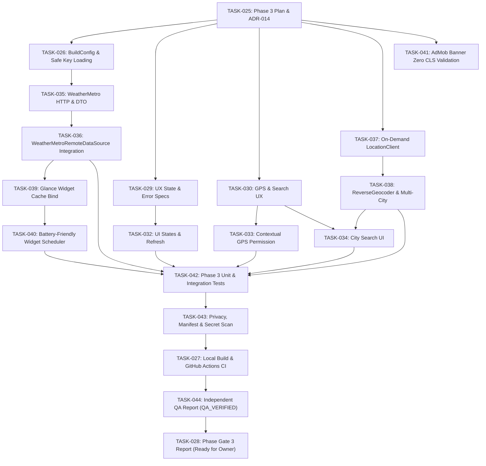

# План виконання Phase 3 / PHASE_3_EXECUTION_PLAN
# Weather API & Location Integration | ROADMAP 2.0

> **Проєкт:** WEATHER (Weather — Smart Forecast)  
> **Репозиторій:** https://github.com/SaVoJ13/wather  
> **Роль:** Agent 0 (Lead Architect / Technical Project Manager)  
> **Дата складання:** 2026-11-23 (Europe/Warsaw)  
> **Статус:** ЗАТВЕРДЖЕНО ВЛАСНИКОМ ДО ВИКОНАННЯ (`Owner Approved` ADR-014)  
> **Нормативна основа:** `docs/governance/CONSTITUTION.uk.md` (v2.0, п. 1, 2.1, 3.1, 3.2, Червоні лінії №1–№9), `docs/governance/DECISIONS.md` (ADR-011, ADR-012, ADR-013, ADR-014), `docs/ROADMAP.uk.md`.

---

## 1. Мета та нормативні рамки Phase 3

Метою **Phase 3: Weather API & Location Integration** є перехід від архітектурних контрактів та тестових адаптерів до повноцінної інтеграції бойового контуру:
1. **Основне джерело погодних даних:** Підключення комерційного API **WeatherMetro Free** (до 16 днів щоденного та 384 годин погодинного прогнозу, до 100 000 запитів/міс за $0) як основного постачальника даних із юридично коректною динамічною атрибуцією.
2. **Сувора заборона fallback на Open-Meteo у релізі:** Некомерційний Open-Meteo Free суворо заборонено використовувати у комерційному контурі з AdMob. При збоях WeatherMetro застосунок повертає дисковий кеш із прапорцем `isStale = true` та повідомленням користувачеві.
3. **Геолокація на вимогу (On-Demand Location):** Реалізація визначення поточних координат користувача виключно в момент натискання кнопки «Моє місце» без фонового відстеження (`ACCESS_BACKGROUND_LOCATION` суворо заборонено).
4. **Пошук та збереження міст:** Автономне онлайн-геокодування та вибір збережених міст (до 10 міст у `WeatherLocalCache`) без обов'язкового дозволу GPS.
5. **Стійкість та захист квот:** Автоматичне об'єднання паралельних запитів (in-flight deduplication), 60-секундний захисний кулдаун при HTTP 429/5xx, Offline-first стратегія Stale-While-Revalidate.
6. **Безпека секретів:** Суворе дотримання Червоної лінії №3 (нуль ключів у чаті, git чи системних логах). Читання конфігураційного ключа через `local.properties` поза git.
7. **Фінансова політика:** Суворе дотримання **ZERO BUDGET POLICY ($0.00)**.
8. **Незалежна перевірка:** Кожне критичне завдання верифікується окремим аудитором **Agent 5 (qa-privacy)** (Червона лінія №9).
9. **Межі переходу:** Заборонено переходити до Phase 4 без окремого `Owner Approved`.

---

## 2. Архітектура компонентів Phase 3

```
┌────────────────────────────────────────────────────────────────────────┐
│                        PRESENTATION LAYER                              │
│  WeatherViewModel ──► WeatherUiState (StateFlow)                       │
│    ├── NowScreen (Hero, Hourly 24h, Metrics, Sun, Dynamic Attribution) │
│    ├── ForecastScreen (14-16 Days List, Range Bars, Day Details)       │
│    ├── LocationsScreen (Multi-City List, Delete, Select)               │
│    ├── SettingsScreen (Language, Units, Theme, Legal Licenses)         │
│    └── SearchCityBottomSheet (On-Demand Geocoding, Zero GPS required)  │
└───────────────────▲────────────────────────────────▲───────────────────┘
                    │                                │
┌───────────────────┴────────────────────────────────┴───────────────────┐
│                          DOMAIN LAYER                                  │
│  WeatherRepository (Interface)        LocationRepository (Interface)   │
│  Models: FullWeatherForecast, HourlyForecastItem, DailyForecastItem,   │
│          CurrentWeather, LocationModel, WeatherCondition, DataSource   │
└───────────────────▲────────────────────────────────▲───────────────────┘
                    │                                │
┌───────────────────┴────────────────────────────────┴───────────────────┐
│                           DATA LAYER                                   │
│  WeatherRepositoryImpl                LocationRepositoryImpl           │
│    ├── In-Flight Deduplication          ├── LocationClient (Foreground)│
│    ├── 60s HTTP 429 Backoff             ├── ReverseGeocoder (Nominatim)│
│    ├── Stale-While-Revalidate           └── GeocodingApiClient         │
│    └── WeatherRemoteDataSource                                         │
│          ├── WeatherMetroRemoteDataSource (Primary Commercial, $0)     │
│          └── OpenMeteoRemoteDataSource (Dev/Test Only, CC BY 4.0)      │
│  Local Persistence:                                                    │
│    └── WeatherLocalCache (SharedPreferences, Multi-City, Corrupt Rec)  │
│  AppWidget:                                                            │
│    └── WeatherGlanceWidget (Reads strictly from WeatherLocalCache)     │
└────────────────────────────────────────────────────────────────────────┘
```

---

## 3. Розподіл завдань між шістьма спеціалізованими агентами

### 👑 Agent 0: Lead Architect / Technical Project Manager
- **TASK-025 (A0.1): Затвердження плану Phase 3 та фіксація ADR-014.**  
  Фіксація рішення Власника `Owner Approved` у `DECISIONS.md`, розробка `PHASE_3_EXECUTION_PLAN.md`, актуалізація `CURRENT_STATE.md` та `TASK_BOARD.md`.
- **TASK-026 (A0.2): Безпека конфігурації та читання ключів API.**  
  Налаштування `app/build.gradle.kts` для безпечної генерації `BuildConfig.WEATHERMETRO_KEY` з локального `local.properties` або змінної оточення без витоку в репозиторій.
- **TASK-027 (A0.3): Координація інтеграції та контроль гілок.**  
  Контроль меж змін, відсутність конфліктів файлів, перевірка сумісності Gradle 8.11.1, моніторинг GitHub Actions CI.
- **TASK-028 (A0.4): Підготовка фінальних звітів Phase Gate 3.**  
  Формування підсумкового звіту `docs/reports/PHASE_GATE_3.md` з реальними доказами, SHA комітів та посиланнями на CI.

### 🎨 Agent 1: Product & UX Designer
- **TASK-029 (A1.1): Специфікація динамічних станів оновлення та збоїв мережі.**  
  Опис поведінки індикатора Stale Data («Оновлено о 14:30 • Застарілі дані»), тексту попередження при перевищенні ліміту HTTP 429, станів Pull-to-Refresh та офлайн-банера.
- **TASK-030 (A1.2): UX контекстного дозволу GPS та пошуку міст.**  
  Сценарії діалогу пояснення GPS (Rationale Dialog), обробка повної відмови користувача (Denied) з плавним поверненням до списку обраних міст без збоїв.
- **TASK-031 (A1.3): Стандартизація розміщення правової атрибуції.**  
  Візуальний стиль напису джерела даних у нижній частині екрана «Зараз» та в розділі «Налаштування» для забезпечення 100% відповідності ліцензійним договорам.

### 📱 Agent 2: Android UI Engineer
- **TASK-032 (A2.1): Інтеграція реактивних UI-станів та Pull-to-Refresh.**  
  Підключення `WeatherMainScreen`, `NowScreen` та `ForecastScreen` до `WeatherViewModel` через `StateFlow<WeatherUiState>`. Додавання жестів оновлення (Swipe-to-Refresh) та індикації застарілих даних.
- **TASK-033 (A2.2): Контекстний запит дозволу GPS у Jetpack Compose.**  
  Реалізація виклику `rememberLauncherForActivityResult(ActivityResultContracts.RequestMultiplePermissions())` у `MainActivity` за ініціативою користувача. Заборона запиту при холодному старті застосунку.
- **TASK-034 (A2.3): Повнофункціональний екран міст та BottomSheet пошуку.**  
  Підключення `SearchCityBottomSheet` та `LocationsScreen` до реального пошуку міст через `LocationRepository`: дебаунс вводу (500 мс), індикатор завантаження, додавання/видалення обраних міст, перемикання активного міста.

### ⚡ Agent 3: Weather & Location Engineer (Головний технічний виконавець Phase 3)
- **TASK-035 (A3.1): Мережевий клієнт та DTO для WeatherMetro Free API.**  
  Створення `WeatherMetroHttpClient.kt`, парсинг JSON-відповіді ендпоінту `https://api.weathermetro.com/v2/forecast` (16 днів daily та 384 години hourly) за допомогою `org.json`. Обробка статусів HTTP 200, 401, 429, 5xx.
- **TASK-036 (A3.2): Реалізація WeatherMetroRemoteDataSource та інтеграція репозиторію.**  
  Підключення бойового `WeatherMetroRemoteDataSource` до `WeatherRepositoryImpl`. Забезпечення Stale-While-Revalidate кешування, блокування повторних запитів під час 60с cooldown та сувора заборона релізного fallback на Open-Meteo.
- **TASK-037 (A3.3): Надійний клієнт геолокації LocationClient.**  
  Реалізація foreground-визначення координат через системний `LocationManager` (GPS_PROVIDER + NETWORK_PROVIDER) або FusedLocation. Обробка точності (precise / approximate) та таймаутів без задіяння `ACCESS_BACKGROUND_LOCATION`.
- **TASK-038 (A3.4): Зворотне геокодування та збереження обраних міст.**  
  Стабільне визначення назви міста за координатами через `ReverseGeocoder` (OSM Nominatim з обов'язковим `User-Agent` + офлайн словник відомих міст), збереження до 10 міст та їх кешів у `WeatherLocalCache`.

### 🧩 Agent 4: Widget & Monetization Engineer
- **TASK-039 (A4.1): Інтеграція Glance AppWidget із бойовим кешем.**  
  Забезпечення відображення реальних погодних даних із `WeatherLocalCache` у віджетах 2x2 та 4x2. Перевірка: віджет ніколи не виконує мережевих HTTP-запитів самостійно.
- **TASK-040 (A4.2): Фоновий планувальник оновлення віджета.**  
  Оновлення віджета через `WeatherWidgetScheduler` та `AlarmManager.setAndAllowWhileIdle` з дельтою 10 хвилин і захистом від виснаження акумулятора.
- **TASK-041 (A4.3): Валідація тестового AdMob Anchored Adaptive Banner.**  
  Перевірка контейнера `AdBannerPlaceholder`: фіксована висота без зміщення інтерфейсу (Zero Cumulative Layout Shift), робота виключно з офіційними Google Test Ad Unit ID, 0% реклами у віджетах.

### 🛡️ Agent 5: QA & Privacy Specialist (Незалежний контроль якості)
- **TASK-042 (A5.1): Модульне та інтеграційне тестування Phase 3.**  
  Розробка та запуск unit-тестів для `WeatherMetroHttpClient`, маперів WeatherMetro, стійкості `LocationRepositoryImpl`, багатомістового кешу та обробки помилок мережі.
- **TASK-043 (A5.2): Незалежний аудит приватності та безпеки секретів.**  
  Сканування коду на відсутність хардкоджених ключів (Red Line #3), перевірка AndroidManifest на відсутність `ACCESS_BACKGROUND_LOCATION`, перевірка логів на відсутність координат.
- **TASK-044 (A5.3): Фінальний аудит Phase 3 та формування PHASE_3_QA_REPORT.md.**  
  Запуск повного набору перевірок (`testDebugUnitTest`, `testReleaseUnitTest`, `lintDebug`, `lintRelease`, `assembleDebug`, `assembleRelease`, перевірка GitHub Actions CI) та офіційний вердикт `QA_VERIFIED` ✅.

---

## 4. Графік залежностей (Dependency Graph)



---

## 5. План тестування та критерії готовності (Definition of Done)

| Критерій | Цільове значення | Метод перевірки |
|---|---|---|
| **Покриття unit-тестами** | **≥ 80 тестів (100% PASS)** | `.\gradlew.bat testDebugUnitTest testReleaseUnitTest` |
| **Android Lint** | **0 errors (abortOnError = true)** | `.\gradlew.bat lintDebug lintRelease` |
| **Релізний контроль Lint** | **0 vital errors** | Автоматично в `.\gradlew.bat assembleRelease` |
| **Збірка Debug APK** | **BUILD SUCCESSFUL** | `app/build/outputs/apk/debug/app-debug.apk` |
| **Збірка Release APK** | **BUILD SUCCESSFUL (R8 shrink)** | `app/build/outputs/apk/release/app-release.apk` |
| **Хмарний CI** | **SUCCESS ✅** | GitHub Actions workflow `.github/workflows/ci.yml` |
| **Приватність GPS** | **0 фонових дозволів** | Сканування `AndroidManifest.xml` (нуль `ACCESS_BACKGROUND_LOCATION`) |
| **Безпека секретів** | **0 ключів у коді/git** | Сканування коду та історії комітів (`AIzaSy`, `apiKey`, тощо) |
| **Фінанси** | **Строго $0.00** | Аудит `THIRD_PARTY.md`, відсутність платних сервісів |
| **Незалежний QA** | **QA_VERIFIED ✅** | Звіт Agent 5 у `docs/qa/PHASE_3_QA_REPORT.md` |

---

## 6. Затвердження та перехід до реалізації

План підготовлено на основі Конституції проєкту v2.0 та офіційного дозволу Власника (ADR-014).
Команда приступає до автономної реалізації завдань Phase 3.
