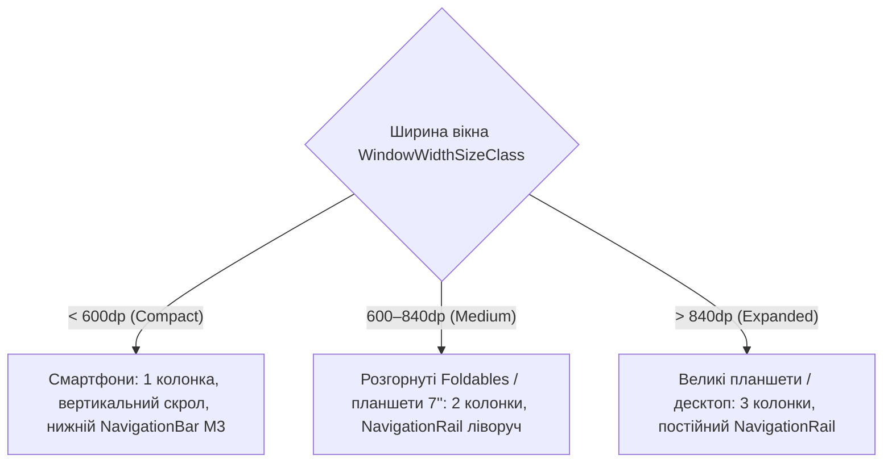

# Дизайн-система продукту / DESIGN_SYSTEM
# Weather — Smart Forecast (Material You v2.2)

> **Версія документа:** 2.2 (Owner Corrections: Anchored Adaptive Banner, Dynamic Type 200%, Window Size Classes, Post-MVP Radar Removal)  
> **Дата оновлення:** 2026-11-22  
> **Відповідальний агент:** Agent 2 (Android UI Engineer)  
> **Статус:** Нормативний документ для реалізації (Phase 1 — UX/UI Design)  
> **Цільова платформа:** Android 8.0+ (API 26..35), Jetpack Compose (Material 3), Jetpack Glance  
> **Стандарти доступності:** WCAG 2.1 AA (Контрастність ≥ 4.5:1 для тексту, ≥ 3.0:1 для великих цифр і графіків, тач-таргети ≥ 48x48dp, масштабування шрифту до 200%)  
> **Базові документи:** `docs/ux/DESIGN_TOKENS.md`, `docs/ux/UI_SPECIFICATION.md`, `docs/governance/CONSTITUTION.uk.md`, `docs/ROADMAP.uk.md`

---

## 1. Філософія дизайну: Google Material You & Live Sky Atmosphere

Дизайн-система **Weather — Smart Forecast** базується на естетиці сучасної мови **Google Material You (Material 3)**. Головна концепція — **«Живе атмосферне занурення»**: інтерфейс не є статичним набором сірих карток, а органічно реагує на погодні умови за вікном користувача, створюючи цілісний контекст через динамічні градієнти, м'які світлопроникні поверхні (Glassmorphism), виразну ієрархію типографіки та делікатний рух.

### Ключові принципи:
1. **Інформативність без візуального шуму (Glanceability):** Найважливіші погодні показники зчитуються за частку секунди.
2. **Атмосферний резонанс:** 7 погодних атмосфер трансформують колірне середовище інтерфейсу як удень, так і вночі.
3. **Строга доступність (Accessibility & Dynamic Type 200%):** Повний контраст за WCAG AA, мінімальні тач-таргети 48x48dp, текстові мітки TalkBack для всіх графічних елементів, нульова залежність виключно від кольору, підтримка системного масштабування тексту до 200% без обрізання (`wrapContentHeight()`).
4. **Повага до комфорту користувача (Reduced Motion):** Повна адаптація до системних налаштувань обмеження руху без втрати функціональності.
5. **Делікатна монетизація з Zero CLS (Anchored Adaptive Banner):** Використання стандарту Google AdMob `AdSize.getCurrentOrientationAnchoredAdaptiveBannerAdSize(context, width)` із попереднім резервуванням динамічної висоти слота (50–90dp) у Compose-дереві. Нульовий зсув макета (CLS = 0). Сувора відсутність реклами у віджетах.
6. **Реалістичні дані без псевдорадара:** Усі погодні дані відповідають реальним фізичним метеорологічним вимірам (температура, опади, вітер, барометричний тиск). Симуляцію радара виключено та перенесено до Post-MVP.

---

## 2. Динамічні погодні атмосфери та колірні палітри

Інтерфейс динамічно обирає колірний профіль на основі поточної погодної умови (WMO WeatherCondition), системної теми (Light/Dark) та фази доби (Day/Night).

### 2.1. Таблиця 7 атмосфер неба

| № | Атмосфера | WMO коди | Денний градієнт (Top ➔ Bottom) | Нічний / Темний градієнт (Top ➔ Bottom) | Surface Tint (Картки) | Акцентний колір | Контраст тексту (WCAG) |
|---|---|---|---|---|---|---|---|
| **1** | **Clear Sky (Ясне небо)** | 0, 1 | `#4A90E2` ➔ `#87CEEB` | `#0B132B` ➔ `#1C2541` | `rgba(255,255,255, 0.20)` (день)<br>`rgba(255,255,255, 0.08)` (ніч) | `#FFB300` (сонце)<br>`#A0C4E2` (місяць) | День: **4.8:1** (AA)<br>Ніч: **11.5:1** (AAA) |
| **2** | **Partly Cloudy (Мінлива хмарність)** | 2 | `#3A7BD5` ➔ `#64B5F6` | `#1A2238` ➔ `#2B3A4A` | `rgba(255,255,255, 0.16)` (день)<br>`rgba(255,255,255, 0.10)` (ніч) | `#FFCA28` (теплий промінь) | День: **4.6:1** (AA)<br>Ніч: **9.8:1** (AAA) |
| **3** | **Overcast (Суцільна хмарність)** | 3 | `#607274` ➔ `#8898AA` | `#1E272E` ➔ `#2F3542` | `rgba(255,255,255, 0.14)` (день)<br>`rgba(255,255,255, 0.08)` (ніч) | `#B0BEC5` (нейтральний хмарний) | День: **4.7:1** (AA)<br>Ніч: **8.9:1** (AAA) |
| **4** | **Rain & Drizzle (Дощ і мряка)** | 51..65, 80..82 | `#37474F` ➔ `#546E7A` | `#1A252C` ➔ `#263238` | `rgba(255,255,255, 0.12)` (день)<br>`rgba(255,255,255, 0.08)` (ніч) | `#4FC3F7` (дощовий блакитний) | День: **5.2:1** (AA)<br>Ніч: **10.1:1** (AAA) |
| **5** | **Thunderstorm (Гроза)** | 95..99 | `#1F1D36` ➔ `#3E2C41` | `#141226` ➔ `#23192D` | `rgba(255,255,255, 0.10)` | `#FFD54F` (спалах блискавки) | День: **8.4:1** (AAA)<br>Ніч: **12.2:1** (AAA) |
| **6** | **Snow (Сніг)** | 71..77, 85..86 | `#78909C` ➔ `#B0BEC5` | `#263238` ➔ `#37474F` | `rgba(255,255,255, 0.22)` (день)<br>`rgba(255,255,255, 0.12)` (ніч) | `#81D4FA` (крижаний акцент) | День: **4.5:1** (AA)<br>Ніч: **9.4:1** (AAA) |
| **7** | **Fog (Туман і серпанок)** | 45, 48 | `#5A6B7C` ➔ `#8898AA` | `#1C232B` ➔ `#2C363F` | `rgba(255,255,255, 0.15)` | `#CFD8DC` (димчастий акцент) | День: **4.6:1** (AA)<br>Ніч: **9.6:1** (AAA) |

### 2.2. Семантичні статусні кольори Material 3

| Семантичний токен | Hex-код (Light) | Hex-код (Dark) | Призначення в погодному контексті | Контраст тексту |
|---|---|---|---|---|
| `sys.color.primary` | `#0061A4` | `#9ECAFF` | Інтерактивні кнопки, виділені вкладки, активні фільтри | ≥ 4.5:1 |
| `sys.color.on-primary` | `#FFFFFF` | `#003258` | Текст і піктограми на акцентних кнопках | ≥ 4.5:1 |
| `sys.color.surface` | `#F8F9FA` | `#121418` | Поверхня екранів, модальних вікон (Bottom Sheets) та діалогів | Базова площина |
| `sys.color.on-surface` | `#1A1C1E` | `#E2E2E6` | Головний контрастний текст на картках і діалогах | ≥ 12.0:1 |
| `sys.color.surface-variant` | `#E1E2EC` | `#2B2F38` | Вторинні плашки, поля пошуку, треки прогресу | Базова площина |
| `sys.color.on-surface-variant` | `#44474F` | `#C4C6D0` | Вторинний пояснювальний текст, одиниці виміру | ≥ 4.5:1 |
| `sys.color.outline` | `#74777F` | `#8E9099` | Тонкі контури та межі (бордери) | ≥ 3.0:1 |
| `sys.color.error` | `#BA1A1A` | `#FFB4AB` | Повідомлення про помилку зв'язку, статус HTTP 429 | ≥ 4.5:1 |
| `status.warning.stale` | `#FFB74D` | `#FFA726` | Плашка попередження про застарілі дані / офлайн-режим | Жовто-бурштиновий |
| `status.warning.stale-text`| `#3E2723` | `#1C0F0A` | Текст на плашці застарілих даних | ≥ 7.0:1 (AAA) |
| `status.success` | `#2E7D32` | `#81C784` | Підтвердження синхронізації та активна локація | ≥ 4.5:1 |

### 2.3. Палітра температурних діапазонів (Canvas Spline Curves & Range Bars)

Для інтуїтивного візуального сприйняття температурний графік сплайнів на Canvas та 16-денні смужки використовують єдиний спектр:
- **Глибокий мороз (< -10°C):** `#1E88E5` (інтенсивний ультрамарин)
- **Помірний холод (-10°C ... 0°C):** `#42A5F5` (блакитний)
- **Прохолодно (0°C ... +10°C):** `#26A69A` (морська хвиля)
- **Помірно (+10°C ... +20°C):** `#66BB6A` (м'який зелений)
- **Тепло (+20°C ... +28°C):** `#FFA726` (сонячний бурштин)
- **Спека (> +28°C):** `#FF7043` ➔ `#D32F2F` (коралово-червоний)

---

## 3. Типографічна система та доступність Dynamic Type (до 200%)

Дизайн-система використовує чистий системний шрифт Android (**Roboto / Google Sans**), що забезпечує швидкий старт додатку без затримок рендерингу та 100% покриття символів кирилиці й латиниці.

| Токен типографіки | Базовий розмір (sp) | Інтерліньяж (dp) | Вага (Weight) | Семантичне застосування в UI |
|---|---|---|---|---|
| `displayHero` | **84sp** | 92dp | ExtraBold (W800) | Головна температура поточної погоди (`+3°`, `-12°`) |
| `displayMedium` | **40sp** | 48dp | Bold (W700) | Велика температура у віджеті Glance (4x2) |
| `headlineMedium` | **28sp** | 36dp | SemiBold (W600) | Назва населеного пункту в заголовку екрана |
| `headlineSmall` | **22sp** | 28dp | Medium (W500) | Заголовки розділів («Зараз», «Прогноз на 16 днів», «Місця») |
| `titleLarge` | **18sp** | 24dp | SemiBold (W600) | Заголовки карток метрик, назви міст у списку пошуку |
| `titleMedium` | **16sp** | 22dp | Medium (W500) | Назви днів тижня, підзаголовки блоків |
| `bodyLarge` | **16sp** | 24dp | Regular (W400) | Текстовий стан погоди («Хмарно з проясненнями», «Помірний дощ») |
| `bodyMedium` | **14sp** | 20dp | Regular (W400) | Числові значення вітру, тиску, вологості, опис помилок |
| `labelLarge` | **14sp** | 20dp | Medium (W500) | Текст на кнопках («Спробувати знову», «Дозволити доступ») |
| `labelSmall` | **11sp** | 16dp | Medium (W500) | Часові мітки погодинної стрічки, відсоток шансу дощу (`70%`) |

### Правила доступності Dynamic Type (масштабування до 200%):
1. **Тільки одиниці `sp`:** Усі текстові стилі використовують виключно `sp`. Заборонено жорстко кодувати висоту рядка в `dp` без динамічної підгонки.
2. **Нульова фіксація висоти контейнерів:** Усі картки, рядки списків та текстові блоки мають модифікатор `wrapContentHeight()`. Заборонено встановлювати фіксований `Modifier.height(...)` на блоки з динамічним текстом.
3. **Гнучкі сітки та автоматичне перенесення рядків (Wrap & Flex):**
   - У сітці метрик 2x2 при збільшенні шрифту > 150% картки адаптивно розширюють свою висоту, зберігаючи відступи.
   - Для погодинних карток при великому масштабуванні значення температури та шансу опадів розміщуються вертикально без стискання.
4. **Захист від обрізання тексту:**
   - Назви міст у заголовку екрана використовують `maxLines = 1` та `overflow = TextOverflow.Ellipsis`.
   - Текстові описи погоди та повідомлення про помилки мають необмежену кількість рядків (`maxLines = Int.MAX_VALUE`) із плавним перенесенням по словах.

---

## 4. Сітка, відступи та розміри дотикових зон

### 4.1. Базова сітка відступів (4dp Base Grid)
- `spacing.xxs` = **4dp** (мікро-відступ між іконкою та відсотком опадів).
- `spacing.xs`  = **8dp** (відступ між елементами в горизонтальному ряду).
- `spacing.sm`  = **12dp** (внутрішній падінг чіпів, бейджів та індикаторів).
- `spacing.md`  = **16dp** (стандартний відступ контенту від країв екрана, падінг у картках).
- `spacing.lg`  = **20dp** (відступ між пов'язаними підсекціями).
- `spacing.xl`  = **24dp** (відступ між головними інформаційними блоками).
- `spacing.xxl` = **32dp** (вертикальний відступ для порожніх станів та екранів помилок).

### 4.2. Шкала радіусів скруглення (Corner Radii)
- `radius.small`  = **8dp** (бейдж застарілих даних, плашка відсотка дощу, статусні чіпи).
- `radius.compact`= **12dp** (картки погодинного прогнозу в горизонтальній смузі).
- `radius.medium` = **16dp** (картки сітки метрик 2x2, елементи списку збережених міст).
- `radius.large`  = **24dp** (головна картка поточної погоди Hero, картка графіка сплайнів).
- `radius.glance` = **28dp** (округлення домашнього віджета Glance під стиль One UI / Pixel Launcher).
- `radius.pill`   = **100dp** (пошуковий рядок SearchBar, кнопки швидких дій, Range Bars).

### 4.3. Вимоги до зон натискання (Touch Targets ≥ 48x48dp)
- Будь-який клікабельний елемент (іконка налаштувань, шестерня TopBar, кнопка GPS, вибір мови, кнопка закриття BottomSheet, рядки міст) має гарантовану зону натискання **не менше 48x48dp**.
- Для компактних іконок застосовується модифікатор `Modifier.sizeIn(minWidth = 48.dp, minHeight = 48.dp)`.

---

## 5. Адаптація під розміри екранів (Window Size Classes)

Інтерфейс застосунку підтримує адаптивне компонування відповідно до специфікації **Material 3 Window Size Classes**:



### 5.1. Compact (< 600dp — смартфони)
- **Компонування:** 1 вертикальна колонка.
- **Навігація:** Нижня панель навігації (`NavigationBar`) із 3 вкладками («Зараз», «Прогноз», «Місця») над слотом AdMob.
- **Картка Hero:** Центрована велика температура 84sp та погодні метрики.
- **Сітка метрик:** 2x2 картки.

### 5.2. Medium (600–840dp — foldables / розгорнуті пристрої / маленькі планшети)
- **Компонування:** 2 колонки з рівномірним розподілом ширини (50% / 50% або 40% / 60%).
  - **Вкладка «Зараз»:** Ліворуч — картка Hero + погодинна стрічка; праворуч — сітка метрик 2x2 + астрономічна картка сходу/заходу сонця.
  - **Вкладка «Прогноз»:** Ліворуч — інтерактивний графік сплайнів на Canvas зі скраббінгом; праворуч — 16-денний список із Range Bars.
  - **Вкладка «Місця»:** Ліворуч — збережені міста та кнопка GPS; праворуч — швидкий пошук із підказками геокодера.
- **Навігація:** Бічна вертикальна рейка `NavigationRail` ліворуч екрана.

### 5.3. Expanded (> 840dp — великі планшети та альбомна орієнтація)
- **Компонування:** 3 інформаційні колонки або майстер-деталь режим.
- **Вкладка «Зараз»:** Колонка 1 — Hero-стан і локація; Колонка 2 — 24h погодинний ряд та опади; Колонка 3 — детальні метрики, схід/захід та джерело даних.
- **Вкладка «Прогноз»:** Ліворуч — розширений графік сплайнів і тренди; праворуч — детальна панель обраного дня без потреби відкриття BottomSheet.
- **Навігація:** Постійний `NavigationRail` з підписами пунктів.

---

## 6. Системний режим зменшення руху (Reduced Motion)

Додаток поважає стан користувача та відстежує системне налаштування Android:  
`Settings.Global.TRANSITION_ANIMATION_SCALE` / `Settings.Global.ANIMATOR_DURATION_SCALE == 0`.

| Компонент | Звичайний режим (Default Motion) | Режим зменшення руху (Reduced Motion) |
|---|---|---|
| **Фон неба** | Легке плавне перетікання градієнта при зміні погоди (Crossfade 350 мс) | Миттєвий перехід (Crossfade ≤ 100 мс) без зміщення |
| **Схід/Захід сонця (Canvas)** | Сонце плавно піднімається дугою до поточної висоти (1200 мс) | Сонце одразу малюється у фінальній точці небосхилу |
| **Графік сплайнів на Canvas** | Плавне проростання ліній/кривих (AnimateFloatAsState 800 мс) | Миттєве креслення сплайнів за розрахованими точками |
| **Скраббінг графіка (Scrubbing)** | Плавне слідування вертикальної лінії-візира за пальцем | Візир стрибає дискретно по точках годин/днів без інерції |
| **Skeleton Loading** | Горизонтальна хвиля Shimmer з плавним блиском (1000 мс) | Статична напівпрозора підкладка з постійною альфою без мерехтіння |
| **Модальні вікна (Bottom Sheets)** | Плавний виїзд знизу з інерцією (Slide-up 250 мс) | Миттєва поява з прозорості (Fade-in 100 мс) |

---

## 7. Glassmorphism токени віджета (Jetpack Glance)

Віджет головного екрана реалізований на базі **Jetpack Glance** з дотриманням системних обмежень `RemoteViews` та енергоощадності:

1. **Підкладка:** `res/drawable/widget_background.xml` із сапфірово-грифельним градієнтом кутом 135°:
   - Початок: `#E6232D48` (90% непрозорий глибокий синій).
   - Середина: `#EA1C243B` (92% нічний індиго).
   - Кінець: `#F2141A2B` (95% вугільний сапфір).
2. **Скляна окантовка (Фаска):** тонка контурна лінія товщиною **1dp** кольору `#38FFFFFF` (22% білого), що імітує скляний відблиск.
3. **Заокруглення:** радіус **28dp**, що ідеально відповідає стилю Pixel Launcher та Samsung One UI.
4. **Розділювачі:** тонкі розділювальні лінії товщиною **0.5dp** кольору `#1AFFFFFF` (10% білого).
5. **Енергоефективність:** жодних анімацій або тикерів; оновлення суворо за системним графіком (10+ хв) або при синхронізації в додатку.
6. **Позначка часу оновлення:** обов'язкове відображення часу останніх даних (наприклад: *«Оновлено: 14:35»*).
7. **Відсутність реклами:** у віджетах реклама **категорично заборонена**.

---

## 8. Рекламний контейнер Google AdMob: Anchored Adaptive Banner (Zero CLS)

Відповідно до погодженої комерційної моделі (ADR-005, ADR-009) та офіційних гайдлайнів Google AdMob:
- **Тип банера:** Офіційний **Anchored Adaptive Banner** (`AdSize.getCurrentOrientationAnchoredAdaptiveBannerAdSize(context, width)`).
- **Динамічний розрахунок висоти:** Залежно від ширини екрана та густини пікселів (DPI) висота банера становить від **50dp до 90dp** (типово 50dp на 360dp-екранах, 60dp на 400dp, до 90dp на планшетах).
- **Гарантія Zero CLS (Нульовий зсув макета):**
  - Висота контейнера обчислюється ДО запиту банера через API AdSize і резервується в компонуванні:
    ```kotlin
    val adSize = AdSize.getCurrentOrientationAnchoredAdaptiveBannerAdSize(context, screenWidthDp)
    val reservedHeightDp = adSize.getHeightInPixels(context) / resources.displayMetrics.density

    Box(
        modifier = Modifier
            .fillMaxWidth()
            .height(reservedHeightDp.dp) // Точне резервування запобігає CLS!
            .background(MaterialTheme.colorScheme.surfaceVariant.copy(alpha = 0.5f))
    ) {
        // Рекламний компонент AdView
    }
    ```
- **Маркування:** Обов'язкова текстова плашка *«Реклама»* / *«Ad»* (висота 14dp, 10sp) у правому верхньому куті контейнера.
- **Офлайн / No-Fill:** Якщо мережа недоступна або банер не повернуто, зарезервований контейнер акуратно показує нейтральну плашку без зсуву погодного контенту.
- **Віджети Glance:** Реклама у віджетах **повністю відсутня**.

