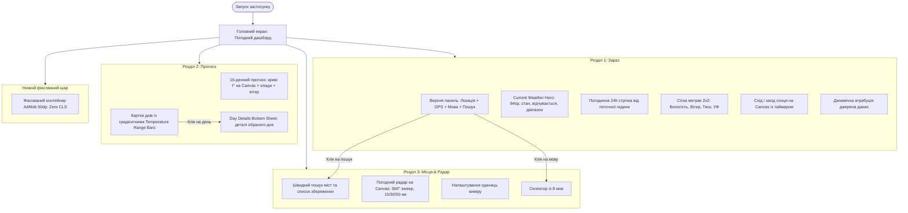
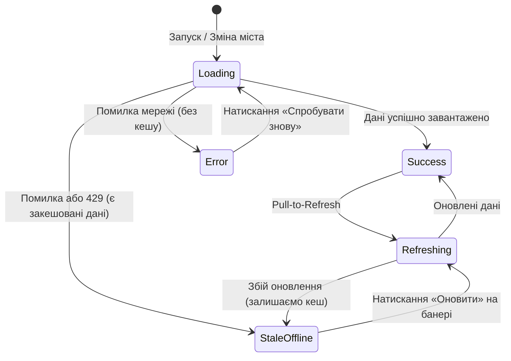

# Специфікація інтерфейсу / UI_SPECIFICATION
# Weather — Smart Forecast (Material You v2.1)

> **Версія документа:** 2.1  
> **Дата оновлення:** 2026-11-22  
> **Відповідальний агент:** Agent 2 (Android UI Engineer)  
> **Статус:** Нормативний документ для реалізації (Phase 1 — UX/UI Design)  
> **Базові документи:** `docs/ux/UX_SPEC.md`, `docs/ux/DESIGN_SYSTEM.md`, `docs/governance/CONSTITUTION.uk.md`

---

## 1. Загальна інформаційна архітектура

Інтерфейс застосунку спроєктовано за принципом **3 функціональних розділів**, скомпонованих у єдиний вертикальний скрол-дашборд з інтуїтивними модальними аркушами (Modal Bottom Sheets) для глибокої деталізації. Це виключає громіздку глибинну навігацію та дозволяє отримати 100% інформації за допомогою свайпу однією рукою.



---

## 2. Детальна специфікація 3 основних розділів інтерфейсу

### 2.1. Розділ 1: «Зараз» (Current Conditions & 24h Dynamics)

Розділ забезпечує миттєве зчитування поточної ситуації та динаміки найближчої доби.

#### 1. Верхня панель дій (`WeatherTopBar`):
- **Назва локації:** назва міста / села (`headlineMedium`, 28sp), іконка типу геопозиції (шпилька для вибраного міста, супутник для GPS).
- **Локалізована дата:** наприклад: *«Неділя, 22 листопада»* (`bodyMedium`, 14sp).
- **Кнопка «Моє місцезнаходження» (`MyLocation`):** тач-таргет 48x48dp, викликає безпечний контекстний діалог пояснення (Rationale).
- **Кнопка «Мова» (`Language`):** тач-таргет 48x48dp, відкриває модальне вікно вибору з 8 мов.
- **Кнопка «Пошук міст» (`Search`):** тач-таргет 48x48dp, відкриває екран пошуку та збережених локацій.

#### 2. Головна картка поточної погоди (`CurrentWeatherHero`):
- **Велика температура:** 84sp, Extra Bold (`displayHero`), знак градуса, локалізований формат (+1°, -12°).
- **Погодний стан:** текстовий опис поточної погоди (`bodyLarge`, 16sp).
- **«Відчувається як»:** показник комфорту з урахуванням вологості та вітру (наприклад: *«Відчувається як -2°»*).
- **Денний діапазон:** стрілочки та екстремуми доби (*«↑ +3°  ↓ -4°»*).
- **Час оновлення та бейдж офлайну:** наприклад: *«Оновлено о 16:45»*; при відсутності зв'язку з'являється чіп-бейджик *«Дані від 14:20 (офлайн)»*.

#### 3. Погодинна стрічка на 24 години (`HourlyForecastRow`):
- Розташована безпосередньо під карткою Hero.
- Горизонтальний скрол на 24 години наперед, починаючи **строго з поточної години**.
- Перший елемент позначається міткою *«Зараз»*.
- Кожна картка (ширина 64dp, скруглення 12dp) містить:
  - Час (наприклад: *«17:00»*, `labelSmall`, 11sp).
  - Контрастну векторну іконку погодного стану (28x28dp).
  - Прогнозовану температуру (+2°).
  - Ймовірність опадів у % синім акцентним кольором (показується при > 10%, наприклад: *«40%»* з мікро-краплею).

#### 4. Сітка метрик 2x2 (`WeatherMetricsGrid`):
Чотири структуровані картки з радіусом скруглення 16dp:
1. **Вологість:** піктограма краплі, відсоток (наприклад: *78%*), текстова оцінка комфорту (*«Висока вологість»*).
2. **Вітер:** піктограма вітру, швидкість у км/год (наприклад: *18 км/год*), стрілка азимуту напрямку (Пн-Зх).
3. **Атмосферний тиск:** піктограма барометра, значення в гПа та мм рт. ст. (наприклад: *1018 гПа / 764 мм*).
4. **УФ-індекс:** піктограма сонця, значення 0..11+ з колірною градацією безпеки (наприклад: *2 — Низький* або *7 — Високий, потрібен захист*).

#### 5. Астрономічна картка (`SunriseSunsetCard`):
- Намальована на Canvas дуга небосхилу із золотистим градієнтом.
- Сонце / місяць розташовуються на дузі пропорційно поточному часу доби.
- Час сходу сонця (наприклад: *07:18*) та час заходу (наприклад: *16:35*).
- Інформаційний текстовий зворотний відлік: *«Захід через 1 год 45 хв»* або *«Ніч. Схід о 07:18»*.
- Загальна тривалість світлового дня (наприклад: *9 год 17 хв*).
- Повна підтримка `reduced-motion`: сонце малюється без анімованого підйому, займаючи статичну позицію.

#### 6. Динамічна атрибуція джерела даних:
- Текстовий рядок у кінці розділу: *«Дані погоди: WeatherMetro Free (ліцензія CC BY 4.0)»* або *«Open-Meteo»*.
- Гарантує 100% юридичну чистоту та дотримання умов безкоштовного API.

---

### 2.2. Розділ 2: «Прогноз» (16-Day Forecast & Trends)

Розділ надає надійне планування на 16 днів уперед із візуалізацією графіків на Canvas.

#### 1. Температурні криві мін/макс на Canvas (`DailyTemperatureChart`):
- Горизонтально скроловий або адаптивний Canvas-графік на 16 днів.
- **Верхня крива (Червоно-бурштинова):** плавна крива Безьє (Cubic Bezier Spline) денних максимумів із числовими підписами над кожною точкою.
- **Нижня крива (Синьо-блакитна):** крива нічних мінімумів із числовими підписами під точками.
- **Коридор коливань:** напівпрозора градієнтна заливка між двома кривими (`rgba(255, 255, 255, 0.08)`).
- **Стовпчики опадів:** у нижній третині графіка сині стовпчики показують прогнозовану кількість опадів у мм та ймовірність у %.
- **Тренди вітру та тиску:** перемикач графіків (Вкладки: «Температура & Опади» / «Вітер & Тиск») дозволяє оцінити наближення циклонів і фронтів.

#### 2. Список карток днів (`DailyForecastList`):
- 16 рядків із висотою не менше 54dp (зручно для натискання пальцем).
- Кожен рядок містить:
  - День: *«Сьогодні»*, *«Завтра»*, або скорочення дня тижня з датою (*«Пн, 23 лист.»*).
  - Іконку прогнозованого погодного стану (32dp).
  - Шанс опадів (якщо > 15%, показується синій бейдж *«65%»*).
  - **Смужку температурного діапазону (Range Bar):** графічний трек із кольоровою градієнтною заливкою, довжина і позиція якої показують розмах температур доби відносно 16-денних абсолютних min/max.
  - Числа температур доби: наприклад: *-2° ... +5°*.
- **Інтерактивність:** тап по будь-якому рядку відкриває `DayDetailsBottomSheet`.

#### 3. Модальний аркуш деталей обраного дня (`DayDetailsBottomSheet`):
- Викликається тапом по дню зі списку або графіку.
- Відображає:
  - Повну дату та розширений текстовий статус погоди.
  - Погодинну сітку саме для цього вибраного дня (00:00 .. 23:00).
  - Точний час сходу та заходу сонця для цієї доби.
  - Сумарні опади в міліметрах (мм) та сніговий покрив у см (за наявності).
  - Максимальні пориви вітру та переважаючий напрямок.
  - Середню вологість та атмосферний тиск.
- Свайп униз або клік на `X` плавно закриває аркуш.

---

### 2.3. Розділ 3: «Місця & Радар» (Locations, Radar & Settings)

Розділ об'єднує керування локаціями, погодний радар та персоналізацію досвіду.

#### 1. Управління вибраними містами (`SavedLocationsSection`):
- Список карток збережених міст користувача (до 10 міст, зберігаються в зашифрованому кеші `WeatherLocalCache`).
- Кожна картка відображає:
  - Назву міста та країну/область.
  - Поточну температуру та іконку стану.
  - Позначку поточної активної локації.
  - Кнопку швидкого видалення або видалення свайпом (Swipe-to-Dismiss) із повідомленням у SnackBar «Скасувати».
- Тап по місту негайно завантажує прогноз для нього та робить його активним на головному екрані.

#### 2. Поле швидкого пошуку міст (`SearchCityBottomSheet`):
- Зручне текстове поле з іконкою лупи та кнопкою очищення `X`.
- Плейсхолдер: *«Пошук міста або села...»*.
- **Дебаунс 400 мс:** запит до геокодера відправляється лише після завершення введення користувачем, заощаджуючи квоту запитів (Zero Budget).
- Список підказок геокодування з назвою населеного пункту, регіоном і країною.
- Кнопка швидкого вибору «Моє поточне місцезнаходження» (викликає GPS).

#### 3. Погодний радар на Canvas (`WeatherRadarCard`):
- Круговий інтерактивний Canvas-компонент, що імітує сучасний доплерівський радар опадів.
- **3 концентричні кільця відстаней:** 15 км, 30 км, 50 км з числовими підписами радіусів.
- **360° sweep-промінь:** м'який світловий промінь, що обертається навколо центру (у звичайному режимі). При увімкненому `reduced-motion` промінь фіксується статично.
- **Хмари опадів (4 рівні інтенсивності):**
  - Легкі опади (Light): `#81D4FA` (м'який блакитний).
  - Помірні опади (Moderate): `#4FC3F7` (насичений синій).
  - Сильні опади (Heavy): `#0288D1` (глибокий штормовий).
  - Злива / град (Extreme): `#D32F2F` (попереджувальний червоний).
- **Часова шкала прогнозу опадів:** слайдер з кроками від `-2 год` (історія) до `+2 год` (прогноз) з кнопками Play / Pause для запуску анімації руху дощових фронтів.

#### 4. Налаштування одиниць виміру (`UnitSettingsSheet`):
- **Температура:** Градуси Цельсія (°C) / Градуси Фаренгейта (°F).
- **Швидкість вітру:** км/год / м/с / милі/год (mph).
- **Атмосферний тиск:** гектопаскалі (гПа / hPa) / міліметри ртутного стовпчика (мм рт. ст. / mmHg).
- **Опади:** міліметри (мм) / дюйми (in).
- Збереження вибору миттєво в `SharedPreferences` без потреби перезавантаження додатку.

#### 5. Селектор 8 мов (`LanguageSelectionDialog`):
- Підтримувані мови:
  1. **Українська (`uk`)** — базова мова проєкту.
  2. **English (`en`)** — міжнародний стандарт.
  3. **Polski (`pl`)** — польська локалізація.
  4. **Deutsch (`de`)** — німецька локалізація.
  5. **Español (`es`)** — іспанська локалізація.
  6. **Italiano (`it`)** — італійська локалізація.
  7. **Français (`fr`)** — французька локалізація.
  8. **Русский (`ru`)** — російська локалізація.
- Окремий пункт: *«Системна мова (за замовчуванням)»*.
- Використовує нативний `AppCompatDelegate.setApplicationLocales` та системний механізм Android 13+ (Per-app Language).
- Перемикання мови негайно оновлює всі тексти в додатку та у віджетах Glance.

---

## 3. Специфікація всіх станів інтерфейсу (UI States)

Інтерфейс має детерміновану кінцеву машину станів (FSM):



### 3.1. Таблиця станів інтерфейсу

| Стан UI | Візуальне відображення | Поведінка анімації | Дії користувача | Оголошення TalkBack |
|---|---|---|---|---|
| **Loading (Початкове)** | Мерехтливий Shimmer-скелетон карток Hero, 24h стрічки, сітки 2x2 та 4 карток прогнозу. | Плавна біжуча хвиля 1000 мс. При `reduced-motion` — статичний напівпрозорий блок. | Елементи неактивні до першої відповіді. | *«Завантаження погоди...»* |
| **Success (Успіх)** | Повний інтерфейс із динамічним градієнтом неба, реальними цифрами, графіками та іконками. | Плавна поява контенту через Crossfade (250 мс). | Доступні всі скроли, тапи, вибір днів, пошук і радар. | *«Погода в місті [Місто]: [Температура], [Стан]»* |
| **Error (Без кешу)** | Центрована картка: ілюстрація обриву зв'язку, текст *«Немає з'єднання»*, опис проблеми, велика акцентна кнопка *«Спробувати знову»* (48dp). | Статична поява (Crossfade 150 мс). | Натискання кнопки повтору, відкриття пошуку збережених міст. | *«Помилка зв'язку. Натисніть кнопку, щоб спробувати знову»* |
| **Stale / Offline (Є кеш)** | Повний інтерфейс із закешованого прогнозу + закріплений верхній банер: *«Офлайн-режим. Дані від [Час]»*, іконка `CloudOff`, кнопка «Оновити». | Статичний банер жовто-бурштинового кольору (контраст тексту ≥ 7:1). | Повний перегляд усіх розділів, ручний запит синхронізації. | *«Офлайн-режим. Показано збережений прогноз від [Час]»* |
| **Empty Search (Пошук)** | Ілюстрація пошуку зі знаком питання, дружній текст: *«Місто не знайдено. Перевірте назву або спробуйте інше»*. | Без анімації. | Введення іншого запиту, вибір збереженого міста. | *«Нічого не знайдено за вашим запитом»* |

---

## 4. Специфікація рекламного банера AdMob (Zero CLS)

- **Розміщення:** зафіксований нижній шар інтерфейсу з урахуванням безпечної зони `navigationBarsPadding()`.
- **Контейнер макета:**
  ```kotlin
  Box(
      modifier = Modifier
          .fillMaxWidth()
          .height(50.dp) // Фіксована висота гарантує Zero CLS!
          .background(MaterialTheme.colorScheme.surface.copy(alpha = 0.95f))
  ) {
      // AdMob View або плейсхолдер під час тестування
  }
  ```
- **Гарантія нульового зсуву макета (Zero CLS):** висота рівно **50dp** зарезервована в дереві Compose з першого кадру. Завантаження реклами не зміщує жодних погодних кнопок або графіків.
- **Маркування:** обов'язкова текстова плашка *«Реклама»* (висота 14dp, шрифт 10sp) у куті слота.
- **Стійкість до помилок:** якщо немає інтернету або AdMob повертає `NO_FILL`, слот залишається охайним нейтральним блоком без аварійних написів.
- **Віджети Glance:** реклама у віджетах **категорично заборонена**.

---

## 5. Специфікація Android App Widgets на Jetpack Glance

Віджети розроблені за суворими вимогами `RemoteViews` без важких обчислень.

### 5.1. Компактний віджет (2x2 клітинки, DpSize 120x100 dp)
- **Стиль:** Glassmorphism підкладка з градієнтом 135°, радіус 28dp, тонка фаска 1dp.
- **Вміст:**
  - Верхній рядок: назва міста (наприклад: *«Київ»*) та іконка поточної погоди (24dp).
  - Центр: велика контрастна температура (28sp bold, наприклад: *«+2°»*).
  - Нижній рядок: денний діапазон (*«↑5° ↓-2°»*) та час оновлення (*«15:30»*).
- **Клік:** відкриває `MainActivity` з відповідним містом.

### 5.2. Розширений преміум-віджет (4x2 клітинки, DpSize 220x100 dp)
- **Стиль:** витончена підкладка сапфірово-грифельного скла із фаскою 1dp `#38FFFFFF` та вертикальним розділювачем між колонками.
- **Ліва колонка (Поточний стан):**
  - Іконка погодного стану (48dp).
  - Велика температура **40sp bold** (*«+1°»*).
  - Текстовий стан погоди (*«Хмарно»*) та рядок «відчувається як» (*«як -2°»*).
  - Мікро-індикатори: вологість (крапля 75%) та вітер (14 км/год).
  - Назва міста та точний час оновлення (*«14:35»*).
- **Права колонка (4-денний прогноз):**
  - Вертикальна таблиця з 4 рядків найближчих днів.
  - Кожен рядок:
    - Локалізований день тижня (наприклад: *«пт»*, *«сб»*, *«нд»*, *«пн»*).
    - Векторна міні-іконка погоди (20dp).
    - Бейдж шансу дощу синім кольором (якщо > 15%, наприклад: *«50%»*).
    - Максимальна та мінімальна температура доби (*«+4° / -1°»*).
    - Тонкий горизонтальний розділювач 0.5dp `#1AFFFFFF`.
- **Енергозбереження:** жодних анімацій або тикерів; оновлення кожні 10..30 хвилин за системним сигналом `AlarmManager.setAndAllowWhileIdle`.

---

## 6. ASCII та текстові макети основних екранів

### 6.1. Головний екран: Розділ 1 («Зараз») та Розділ 2 («Прогноз»)

```text
+-------------------------------------------------------------+
| [GPS]  Київ, Україна                     [Мова]   [Пошук]   |
|        Неділя, 22 листопада                                 |
+-------------------------------------------------------------+
|                                                             |
|                         +1°                                 |
|                 Здебільшого хмарно                          |
|             Відчувається як -2° | ↑ +4°  ↓ -2°              |
|                   Оновлено о 16:45                          |
|                                                             |
+-------------------------------------------------------------+
| ПОГОДИННО (24 ГОДИНИ)                                       |
| [Зараз]    [17:00]    [18:00]    [19:00]    [20:00]   ...   |
|  (Хмара)   (Хмара)    (Дощ)      (Дощ)      (Місяць)        |
|   +1°        +1°        0°        -1°        -1°            |
|   10%        20%       65%💧      80%💧       15%           |
+-------------------------------------------------------------+
| СІТКА МЕТРИК                                                |
| +-------------------------+ +-----------------------------+ |
| | [💧] Вологість: 78%     | | [💨] Вітер: 18 км/год       | |
| |      Висока вологість   | |      Північно-західний      | |
| +-------------------------+ +-----------------------------+ |
| | [⏱] Тиск: 1018 гПа      | | [☀️] УФ-індекс: 1            | |
| |      764 мм рт. ст.     | |      Низький (безпечно)     | |
| +-------------------------+ +-----------------------------+ |
+-------------------------------------------------------------+
| СХІД ТА ЗАХІД СОНЦЯ                                         |
|              . - - - * (Сонце) - - - .                      |
|            /                           \                    |
|       07:18                             16:35               |
|       Схід                              Захід               |
|             Захід сонця через 1 год 45 хв                   |
+-------------------------------------------------------------+
| ПРОГНОЗ НА 16 ДНІВ ТА ТРЕНДИ                                |
|   +5°  /‾‾\___                                              |
|        \      \___  (Температурні криві на Canvas)          |
|   -3°   \_________\                                         |
|                                                             |
|   Сьогодні    (Хмара)   30%   [-2° =====|==== +4°]   -2°..+4°|
|   Завтра      (Дощ)     75%💧 [-1° ====|====== +5°]  -1°..+5°|
|   Вівторок    (Сонце)   10%   [ 0° =====|==== +6°]    0°..+6°|
|   Середа      (Сніг)    60%❄️ [-4° ===|====== +1°]   -4°..+1°|
|   ... (16 днів)                                             |
+-------------------------------------------------------------+
| ПОГОДНИЙ РАДАР (360°)                                       |
|                  /     |     \                              |
|                /   (30 км)     \                            |
|               |    -- [•] --    |  Промінь 360°             |
|                \   (15 км)     /   Хмари опадів             |
|                  \     |     /                              |
|      [-2h] ---- [ Зараз ] ---- [+2h]   [ ▶ Грати ]          |
+-------------------------------------------------------------+
| Дані: WeatherMetro Free (ліцензія CC BY 4.0)                |
+-------------------------------------------------------------+
| [Реклама] Google AdMob Банер (фіксована висота 50dp)        |
+-------------------------------------------------------------+
```

### 6.2. Розширений віджет Glance (4x2 клітинки)

```text
+-------------------------------------------------------------+
| [•] Київ • 14:35          |  пт  (Дощ)     50%💧  +4° / -1° |
|                           |---------------------------------|
|  (🌧️)    +1°              |  сб  (Хмара)   20%    +3° / -2° |
|  48dp     40sp bold       |---------------------------------|
|  Хмарно, відчувається як -2°|  нд  (Сонце)   10%    +5° /  0° |
|  💧 75%   💨 14 км/год     |---------------------------------|
|                           |  пн  (Сніг)    65%❄️  +1° / -4° |
+-------------------------------------------------------------+
   ^ Скляна фаска 1dp (#38FFFFFF) та кути 28dp (Glassmorphism)
```

