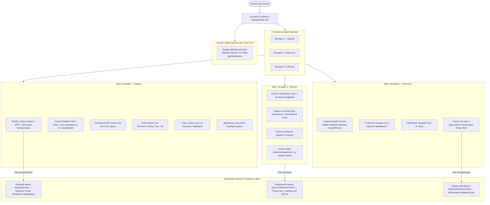

# Специфікація інтерфейсу / UI_SPECIFICATION
# Weather — Smart Forecast (Material You v2.2)

> **Версія документа:** 2.2 (Owner Corrections: 3 Main Tabs, Separate SettingsScreen, Light/Dark Mockups, Realistic Meteorology, Anchored Adaptive Banner Zero CLS, Glance Widgets, Dynamic Type 200%)  
> **Дата оновлення:** 2026-11-22  
> **Відповідальний агент:** Agent 2 (Android UI Engineer)  
> **Статус:** Нормативний документ для реалізації (Phase 1 — UX/UI Design)  
> **Базові документи:** `docs/ux/DESIGN_SYSTEM.md`, `docs/ux/DESIGN_TOKENS.md`, `docs/governance/CONSTITUTION.uk.md`, `docs/ROADMAP.uk.md`

---

## 1. Загальна інформаційна архітектура та навігація

Інтерфейс застосунку спроєктовано за моделлю **3 головних вкладок навігації** (`NavigationBar` Material 3) з окремим повнофункціональним екраном налаштувань (`SettingsScreen`), доступним за іконкою шестерні у TopBar, та контекстними модальними аркушами (Modal Bottom Sheets) для пошуку та деталізації.



---

## 2. Детальна специфікація трьох основних вкладок

### 2.1. Вкладка 1: «Зараз» (Current Conditions)

Забезпечує миттєве, кришталево чітке зчитування поточної погодної ситуації.

1. **Верхня панель дій (`WeatherTopBar`):**
   - **Назва локації:** назва населеного пункту (`headlineMedium`, 28sp), іконка типу геопозиції (шпилька для вибраного міста, супутник для GPS).
   - **Локалізована дата:** наприклад: *«Неділя, 22 листопада»* (`bodyMedium`, 14sp).
   - **Кнопка «Моє місцезнаходження» (`MyLocation`):** тач-таргет 48x48dp, викликає безпечний контекстний діалог пояснення (Rationale).
   - **Кнопка «Налаштування» (`Settings`):** іконка шестерні (тач-таргет 48x48dp), відкриває окремий `SettingsScreen`.
2. **Головна картка поточної погоди (`CurrentWeatherHero`):**
   - **Велика температура:** 84sp, Extra Bold (`displayHero`), знак градуса, локалізований формат (+3°, -12°).
   - **Погодний стан:** текстовий опис поточної погоди (`bodyLarge`, 16sp).
   - **«Відчувається як»:** показник комфорту з урахуванням вологості та вітру (наприклад: *«Відчувається як -1°»*).
   - **Денний діапазон:** стрілочки та екстремуми доби (*«↑ +6°  ↓ -2°»*).
   - **Час оновлення та бейдж офлайну:** наприклад: *«Оновлено о 16:45»*; при відсутності зв'язку з'являється чіп-бейджик *«Дані від 14:20 (офлайн)»*.
3. **Погодинна стрічка на 24 години (`HourlyForecastRow`):**
   - Горизонтальний скрол на 24 години, починаючи **строго з поточної години**.
   - Перший елемент позначається міткою *«Зараз»*.
   - Кожна картка (ширина 64dp, скруглення 12dp, `wrapContentHeight()`) містить:
     - Час (наприклад: *«17:00»*, `labelSmall`, 11sp).
     - Контрастну векторну іконку погодного стану (28x28dp).
     - Прогнозовану температуру (+3°).
     - Ймовірність опадів у % синім акцентним кольором (показується при > 10%, наприклад: *«60%»* з мікро-краплею).
4. **Сітка метрик 2x2 (`WeatherMetricsGrid`):**
   Чотири структуровані картки з радіусом скруглення 16dp:
   - **Вологість:** піктограма краплі, відсоток (наприклад: *76%*), текстова оцінка комфорту (*«Комфортна вологість»*).
   - **Вітер:** піктограма вітру, швидкість у км/год (наприклад: *18 км/год*), стрілка азимуту напрямку (*Пн-Зх*).
   - **Атмосферний тиск:** піктограма барометра, значення в гПа та мм рт. ст. (наприклад: *1018 гПа / 764 мм*).
   - **УФ-індекс:** піктограма сонця, значення 0..11+ з колірною градацією безпеки (наприклад: *1 — Низький* або *6 — Помірний*).
5. **Астрономічна картка сходу й заходу сонця (`SunriseSunsetCard`):**
   - Намальована на Canvas дуга небосхилу із золотистим градієнтом.
   - Сонце розташовується на дузі пропорційно поточному часу доби.
   - Точний час сходу сонця (наприклад: *07:18*) та час заходу (наприклад: *16:35*).
   - Інформаційний текстовий таймер: *«Захід сонця через 1 год 45 хв»* або *«Ніч. Схід о 07:18»*.
   - Повна підтримка `reduced-motion`: сонце малюється без анімованого підйому, займаючи статичну позицію.
6. **Динамічна ліцензійна атрибуція джерела даних:**
   - Текстовий рядок у кінці розділу: *«Дані погоди: Open-Meteo (ліцензія CC BY 4.0)»*.
   - Гарантує 100% юридичну чистоту та дотримання умов відкритого некомерційного використання.

---

### 2.2. Вкладка 2: «Прогноз» (16-Day Forecast & Spline Charts)

1. **Інтерактивний температурний графік сплайнів мін/макс на Canvas (`DailyTemperatureSplineChart`):**
   - Горизонтально скроловий або адаптивний Canvas-графік на 16 днів.
   - **Верхній сплайн (Червоно-бурштиновий):** плавна кубічна крива Безьє (Cubic Bezier Spline) денних максимумів із числовими підписами над кожною точкою.
   - **Нижній сплайн (Синьо-блакитний):** кубічна крива Безьє нічних мінімумів із числовими підписами під точками.
   - **Коридор коливань:** напівпрозора градієнтна заливка між двома сплайнами (`rgba(255, 255, 255, 0.08)`).
   - **Стовпчики опадів:** у нижній третині графіка сині вертикальні стовпчики показують прогнозовану кількість опадів у міліметрах (мм) та відсоток ймовірності.
   - **Інтерактивний скраббінг (Scrubbing / Touch Visualizer):**
     - При дотику пальцем до графіка на Canvas з'являється тонка вертикальна пунктирна лінія-візир.
     - Візир слідує за пальцем користувача і відображає спливаючий плаваючий Tooltip: дату, максимальну/мінімальну температуру, ймовірність і об'єм опадів.
     - При ввімкненому системному `reduced-motion` візир переміщується дискретно по вузлових точках без інерційного трекінгу.
   - **Тренди тиску та вітру:** перемикач вкладок графіка («Температура & Опади» / «Вітер & Тиск») дозволяє своєчасно бачити наближення атмосферних фронтів.
2. **Список 16 днів із відносними Temperature Range Bars (`DailyForecastList`):**
   - 16 рядків із висотою не менше 54dp (ідеально для пальця).
   - Кожен рядок містить:
     - День: *«Сьогодні»*, *«Завтра»*, або скорочення дня тижня з датою (*«Пн, 23 лист.»*).
     - Іконку прогнозованого погодного стану (28dp).
     - Шанс опадів (якщо > 15%, показується синій бейдж *«65%💧»*).
     - **Відносну смужку температурного діапазону (Temperature Range Bar):** горизонтальний трек довжиною 100dp зі скругленням pill (100dp). Кольоровий градієнтний відрізок відображає денний розмах [мін...макс] пропорційно до абсолютного 16-денного діапазону (наприклад, від -5° до +8°).
     - Числові значення: наприклад: *-2° ... +5°*.
   - **Інтерактивність:** клік на будь-який день списку відкриває `DayDetailsBottomSheet`.

---

### 2.3. Вкладка 3: «Місця» (Saved Locations & Management)

1. **Список збережених локацій (`SavedLocationsList`):**
   - До 10 збережених міст у зашифрованому локальному сховищі `WeatherLocalCache`.
   - Кожна картка міста містить:
     - Назву міста та країну/область (*«Київ, Україна»*, *«Варшава, Польща»*, *«Львів, Україна»*).
     - Поточну температуру великим шрифтом (*+3°*, *+5°*).
     - Іконку поточного погодного стану.
     - **Бейдж активної локації:** якщо місто зараз відображається на головному екрані, воно маркується чіпом `АКТИВНЕ` акцентного кольору `sys.color.primary`.
   - **Swipe-to-Dismiss (Видалення свайпом):**
     - Свайп картки ліворуч або праворуч видаляє місто зі списку з плавною анімацією.
     - Одразу з'являється `Snackbar` із кнопкою *«Скасувати»* (Undo) тривалістю 4 секунди.
   - **Тап по картці:** негайно робить це місто активним та перемикає додаток на вкладку «Зараз».
2. **Кнопка швидкого відкриття пошуку:**
   - Помітна картка-кнопка у верхній частині вкладки: поле пошуку із лупою та плейсхолдером *«Знайти нове місто...»*, тап по якій відкриває `SearchCityBottomSheet`.
3. **Кнопка «Моє місцезнаходження» (GPS):**
   - Розташована на видному місці з іконкою супутника / геолокації.
   - Спрацьовує **виключно за явним кліком користувача** (відповідно до вимог приватності).
   - Показує пояснювальний діалог Rationale перед викликом системного запиту дозволу Android.

---

## 3. Окремий екран налаштувань (`SettingsScreen`)

Доступний за натисканням на іконку шестерні у верхній панелі TopBar. Має стандартний для Android чистий вигляд списку категорій Material 3:

```text
+-------------------------------------------------------------+
| [←] Налаштування                                            |
+-------------------------------------------------------------+
| ОДИНИЦІ ВИМІРУ                                              |
|                                                             |
| Температура                                                 |
| (•) Цельсій (°C)             ( ) Фаренгейт (°F)             |
|                                                             |
| Швидкість вітру                                             |
| (•) км/год       ( ) м/с      ( ) милі/год (mph)            |
|                                                             |
| Атмосферний тиск                                            |
| (•) гПа (hPa)                ( ) мм рт. ст. (mmHg)          |
|                                                             |
| Опади                                                       |
| (•) Міліметри (мм)           ( ) Дюйми (in)                 |
+-------------------------------------------------------------+
| МОВА ДОДАТКУ (8 МОВ)                                        |
| Поточна мова: Українська                                    |
| [ Селектор: Українська, English, Polski, Deutsch, ...]     |
+-------------------------------------------------------------+
| ЮРИДИЧНА ІНФОРМАЦІЯ ТА ДЖЕРЕЛО                              |
| Постачальник даних: Open-Meteo Weather API                  |
| Ліцензія даних: Creative Commons Attribution 4.0 (CC BY 4.0)|
| Модель сервісу: Безкоштовний некомерційний API              |
| Політика конфіденційності (GPS не відстежується у фоні)     |
| Реклама: Google AdMob (Суворо відсутня у віджетах)         |
| Версія додатку: 1.0.0 (Build 17)                            |
+-------------------------------------------------------------+
```

### Деталі розділів SettingsScreen:
1. **Одиниці виміру:** миттєво зберігаються у локальних налаштуваннях та динамічно перераховують значення на всіх трьох вкладках та у віджетах без перезапуску.
2. **Селектор 8 мов:** підтримуються 8 мовних пакетів:
   - Українська (`uk`) — базова мова проєкту;
   - English (`en`);
   - Polski (`pl`);
   - Deutsch (`de`);
   - Español (`es`);
   - Italiano (`it`);
   - Français (`fr`);
   - Русский (`ru`);
   - Окремий пункт: *«Системна мова (за замовчуванням)»*.
   Використовує нативний Android Per-App Language API (`AppCompatDelegate.setApplicationLocales`).
3. **Юридична інформація:** прозора атрибуція Open-Meteo, гарантія відсутності фонового стеження за локацією, підтвердження повної відсутності реклами у віджетах.

---

## 4. Правила адаптивності та доступності Dynamic Type (до 200%)

### 4.1. Поведінка шрифтів Dynamic Type (200%):
- Усі шрифтові розміри задано суворо в одиницях **`sp`**.
- Усі контейнери карток використовують `Modifier.wrapContentHeight()`. Фіксовані висоти `Modifier.height(...)` для текстових карток суворо заборонені.
- Заголовки міст використовують автоматичне багатокрапкове скорочення (`TextOverflow.Ellipsis`) при досягненні межі ширини.
- Усі тач-таргети зберігають розмір не менше 48x48dp навіть при максимальному масштабуванні.

### 4.2. Адаптація під розміри екранів (Window Size Classes):

| Клас розміру вікна | Ширина екрана | Компонування інтерфейсу | Поведінка навігації |
|---|---|---|---|
| **Compact** | < 600dp (Смартфони) | 1 вертикальна колонка. Картка Hero 84sp, сітка метрик 2x2, список 16 днів. | Нижня панель `NavigationBar` Material 3 над банером AdMob. |
| **Medium** | 600–840dp (Foldables, міні-планшети) | 2 адаптивні колонки: ліворуч Hero + 24h ряд, праворуч сітка метрик + Canvas-графік або список днів. | Бічна панель `NavigationRail` ліворуч. |
| **Expanded** | > 840dp (Планшети, десктоп) | 3 паралельні колонки або Master-Detail: локація + стан, розширений графік сплайнів, панель деталей без необхідності BottomSheet. | Постійний розширений `NavigationRail`. |

---

## 5. Специфікація станів інтерфейсу (UI States)

Кінцева машина станів екранів забезпечує плавний перехід без мерехтіння:

| Стан UI | Візуальне відображення | Поведінка анімації | Дії користувача | Оголошення TalkBack |
|---|---|---|---|---|
| **Loading (Початкове)** | Мерехтливий Shimmer-скелетон карток Hero, 24h стрічки, сітки 2x2 та прогнозу. | Плавна біжуча хвиля 1000 мс. При `reduced-motion` — статичний напівпрозорий блок. | Елементи неактивні до першої відповіді. | *«Завантаження погоди...»* |
| **Success (Успіх)** | Повний інтерфейс із динамічним градієнтом неба, реальними цифрами, графіками та іконками. | Плавна поява контенту через Crossfade (250 мс). | Доступні всі скроли, скраббінг графіка, тапи, вибір днів, пошук і налаштування. | *«Погода в місті [Місто]: [Температура], [Стан]»* |
| **Error (Без кешу)** | Центрована картка: ілюстрація обриву зв'язку, текст *«Немає з'єднання»*, опис проблеми, велика акцентна кнопка *«Спробувати знову»* (48dp). | Статична поява (Crossfade 150 мс). | Натискання кнопки повтору, перехід на збережені міста. | *«Помилка зв'язку. Натисніть кнопку, щоб спробувати знову»* |
| **Stale / Offline (Є кеш)** | Повний інтерфейс із закешованого прогнозу + закріплений верхній банер: *«Офлайн-режим. Дані від [Час]»*, іконка `CloudOff`, кнопка «Оновити». | Статичний банер жовто-бурштинового кольору (контраст тексту ≥ 7:1). | Повний перегляд усіх вкладок, ручний запит синхронізації. | *«Офлайн-режим. Показано збережений прогноз від [Час]»* |
| **Empty Search (Пошук)** | Ілюстрація пошуку зі знаком питання, дружній текст: *«Місто не знайдено. Перевірте назву або спробуйте інше»*. | Без анімації. | Введення іншого запиту, вибір збереженого міста. | *«Нічого не знайдено за вашим запитом»* |

---

## 6. Google AdMob: Anchored Adaptive Banner (Zero CLS)

- **Тип банера:** Офіційний **Anchored Adaptive Banner** (`AdSize.getCurrentOrientationAnchoredAdaptiveBannerAdSize(context, width)`).
- **Динамічний розрахунок висоти слота:** Залежно від ширини пристрою та DPI висота слота становить від **50dp до 90dp**.
- **Гарантія нульового зсуву (Zero CLS):**
  - Висота контейнера обчислюється і резервується в компонуванні ДО завантаження оголошення:
  ```kotlin
  val adSize = AdSize.getCurrentOrientationAnchoredAdaptiveBannerAdSize(context, screenWidthDp)
  val reservedHeightDp = adSize.getHeightInPixels(context) / resources.displayMetrics.density

  Box(
      modifier = Modifier
          .fillMaxWidth()
          .height(reservedHeightDp.dp) // Гарантія нульового зсуву макета (CLS = 0)
          .background(MaterialTheme.colorScheme.surfaceVariant.copy(alpha = 0.5f))
  ) {
      // AdView
  }
  ```
- **Маркування:** текстова мітка *«Реклама»* / *«Ad»* (висота 14dp, шрифт 10sp) у куті слота.
- **Офлайн / No-Fill:** у разі відсутності інтернету або помилки AdMob слот залишається охайним порожнім блоком зарезервованого розміру без зміщення контенту.
- **Віджети Glance:** реклама у віджетах **суворо заборонена**.

---

## 7. Специфікація Android App Widgets на Jetpack Glance

### 7.1. Компактний віджет (2x2 клітинки, DpSize 120x100 dp)
- **Стиль:** Glassmorphism підкладка з градієнтом 135° (від сапфірового `#E6232D48` до вугільного `#F2141A2B`), радіус 28dp, тонка фаска 1dp `#38FFFFFF`.
- **Вміст:**
  - Верхній рядок: назва міста (*«Київ»*) та іконка поточної погоди (24dp).
  - Центр: велика температура (**28sp bold**, *«+3°»*).
  - Нижній рядок: денний діапазон (*«↑6° ↓-2°»*) та час оновлення (*«Оновлено 15:30»*).
- **Клік:** відкриває `MainActivity` з активним містом.

### 7.2. Розширений преміум-віджет (4x2 клітинки, DpSize 220x100 dp)
- **Стиль:** витончена підкладка сапфірово-грифельного скла із фаскою 1dp `#38FFFFFF`, кутами 28dp та тонким розділювачем між колонками.
- **Ліва колонка (Поточний стан):**
  - Велика погодна іконка (44dp).
  - Велика температура **40sp bold** (*«+3°»*).
  - Текстовий стан погоди (*«Хмарно, дощ»*) та «відчувається як» (*«як -1°»*).
  - Мікро-показники: вологість (крапля 76%) та вітер (18 км/год).
  - Назва міста та точний час оновлення (*«Київ • 15:30»*).
- **Права колонка (4-денний прогноз):**
  - 4 акуратні рядки найближчих днів:
    - День тижня (*«пт»*, *«сб»*, *«нд»*, *«пн»*).
    - Міні-іконка погоди (20dp).
    - Шанс дощу синім кольором (*«60%💧»*).
    - Екстремуми доби (*«+5° / -1°»*).
- **Енергоощадність:** жодних анімацій або тикерів; оновлення суворо за системним сигналом не частіше 1 разу на 15–30 хвилин.

---

## 8. Повні візуальні макети (ASCII / Markdown)

### 8.1. Вкладка 1: «Зараз» — Світла тема (Київ, реальні метеодані)

```text
+-------------------------------------------------------------+
| [GPS]  Київ, Україна                                    [⚙️] |
|        Неділя, 22 листопада                                 |
+-------------------------------------------------------------+
|                                                             |
|                            +3°                              |
|                    Помірний дощ                             |
|               Відчувається як -1° | ↑ +6°  ↓ -2°            |
|                     Оновлено о 16:45                        |
|                                                             |
+-------------------------------------------------------------+
| ПОГОДИННО (24 ГОДИНИ ВІД ПОТОЧНОЇ)                          |
| [Зараз]    [17:00]    [18:00]    [19:00]    [20:00]   ...   |
|  (🌧️)       (🌧️)       (☁️)       (☁️)       (🌙)          |
|   +3°        +3°        +2°        +1°         0°           |
|   70%💧      60%💧      30%        15%        10%           |
+-------------------------------------------------------------+
| СІТКА МЕТРИК                                                |
| +-------------------------+ +-----------------------------+ |
| | [💧] Вологість: 76%     | | [💨] Вітер: 18 км/год       | |
| |      Комфортний рівень  | |      Північно-західний (ПнЗх)| |
| +-------------------------+ +-----------------------------+ |
| | [⏱] Тиск: 1018 гПа      | | [☀️] УФ-індекс: 1            | |
| |      764 мм рт. ст.     | |      Низький (безпечно)     | |
| +-------------------------+ +-----------------------------+ |
+-------------------------------------------------------------+
| СХІД ТА ЗАХІД СОНЦЯ                                         |
|              . - - - * (Сонце) - - - .                      |
|            /                           \                    |
|       07:18                             16:35               |
|       Схід                              Захід               |
|             Захід сонця через 1 год 45 хв                   |
+-------------------------------------------------------------+
| Дані: Open-Meteo Weather API (ліцензія CC BY 4.0)           |
+-------------------------------------------------------------+
| [• Зараз]               [Прогноз]                  [Місця]  |
+-------------------------------------------------------------+
| [Реклама] Google AdMob Anchored Adaptive Banner (60dp)      |
+-------------------------------------------------------------+
```

---

### 8.2. Вкладка 1: «Зараз» — Темна тема (Варшава, реальні метеодані)

```text
+-------------------------------------------------------------+
| [•]    Варшава, Польща                                  [⚙️] |
|        Неділя, 22 листопада                                 |
+-------------------------------------------------------------+
|                                                             |
|                            +5°                              |
|                    Хмарно з проясненнями                    |
|               Відчувається як +2° | ↑ +7°  ↓ +1°            |
|                     Оновлено о 16:40                        |
|                                                             |
+-------------------------------------------------------------+
| ПОГОДИННО (24 ГОДИНИ ВІД ПОТОЧНОЇ)                          |
| [Зараз]    [17:00]    [18:00]    [19:00]    [20:00]   ...   |
|  (⛅)       (⛅)       (☁️)       (🌙)       (🌙)          |
|   +5°        +5°        +4°        +3°        +2°           |
|   15%        10%        10%        10%         5%           |
+-------------------------------------------------------------+
| СІТКА МЕТРИК                                                |
| +-------------------------+ +-----------------------------+ |
| | [💧] Вологість: 68%     | | [💨] Вітер: 14 км/год       | |
| |      Помірна вологість  | |      Західний (Зх)          | |
| +-------------------------+ +-----------------------------+ |
| | [⏱] Тиск: 1015 гПа      | | [☀️] УФ-індекс: 1            | |
| |      761 мм рт. ст.     | |      Низький (безпечно)     | |
| +-------------------------+ +-----------------------------+ |
+-------------------------------------------------------------+
| СХІД ТА ЗАХІД СОНЦЯ                                         |
|              . - - - - - - - - - - - .                      |
|            /                           \                    |
|       07:05                             15:48               |
|       Схід                              Захід               |
|                 Ніч. Схід сонця о 07:05                     |
+-------------------------------------------------------------+
| Дані: Open-Meteo Weather API (ліцензія CC BY 4.0)           |
+-------------------------------------------------------------+
| [• Зараз]               [Прогноз]                  [Місця]  |
+-------------------------------------------------------------+
| [Реклама] Google AdMob Anchored Adaptive Banner (60dp)      |
+-------------------------------------------------------------+
```

---

### 8.3. Вкладка 2: «Прогноз» — Світла тема (Київ, сплайн-графік зі скраббінгом та 16 днів)

```text
+-------------------------------------------------------------+
| Прогноз на 16 днів — Київ                               [⚙️] |
+-------------------------------------------------------------+
| ТЕМПЕРАТУРНИЙ ГРАФІК СПЛАЙНІВ НА CANVAS (ЗІ СКРАББІНГОМ)     |
| [• Температура & Опади]            [Вітер & Атмосферний тиск]|
|                                                             |
|   +8°       .+6°.__                                         |
|   +5°    .-'       `--.+3°.       (Сплайн денних максимумів)|
|    0°  ======================== 0°C ======================= |
|   -2°                      `-.-2° (Сплайн нічних мінімумів) |
|   -5°                             | (Візир скраббінгу)      |
|                                   V                         |
|        [ Пн, 23 лист: Max +3° / Min -2° | Дощ 1.2 мм (60%) ]|
|   Опади:                                                    |
|   2 мм |    ||                                              |
|   0 мм |____||________||________.. (Стовпчики опадів мм)    |
|        22   23        24        25        26 листоп.        |
+-------------------------------------------------------------+
| ДЕННИЙ СПИСОК (16 ДНІВ З RANGE BARS)                        |
|                                                             |
| Сьогодні    (🌧️) 70%💧   [-2°   ====|=====   +6°]   -2°..+6°|
| Завтра      (🌧️) 60%💧   [-1°    ===|====    +5°]   -1°..+5°|
| Вівторок    (⛅) 20%     [ 0°     ==|===     +4°]    0°..+4°|
| Середа      (☁️) 15%     [-3°   ====|==      +2°]   -3°..+2°|
| Четвер      (❄️) 55%❄️   [-5° =====|         -1°]   -5°..-1°|
| П'ятниця    (☀️) 10%     [-4°   ====|===     +3°]   -4°..+3°|
| Субота      (⛅) 10%     [-2°    ===|====    +5°]   -2°..+5°|
| Неділя      (🌧️) 45%💧   [ 0°      =|=====   +7°]    0°..+7°|
| ... (до 16 днів)                                            |
+-------------------------------------------------------------+
| [Зараз]                 [• Прогноз]                [Місця]  |
+-------------------------------------------------------------+
| [Реклама] Google AdMob Anchored Adaptive Banner (60dp)      |
+-------------------------------------------------------------+
```

---

### 8.4. Вкладка 2: «Прогноз» — Темна тема (Варшава, графік та Range Bars)

```text
+-------------------------------------------------------------+
| Прогноз на 16 днів — Варшава                            [⚙️] |
+-------------------------------------------------------------+
| ТЕМПЕРАТУРНІ КРИВІ НА CANVAS                                |
|   +7°    .-+7°.__                                           |
|   +4°  -'        `--.+4°.                                   |
|    0°  ======================== 0°C ======================= |
|   +1°  `-.+1°._______.-+1°                                  |
|   Опади (мм):                                               |
|   1 мм |         |                                          |
|   0 мм |_________|________..                                |
|        22        23       24       25      26 лист.         |
+-------------------------------------------------------------+
| СПИСОК ДНІВ З TEMPERATURE RANGE BARS                        |
| Сьогодні    (⛅) 15%     [ +1°      =|======  +7°]   +1°..+7°|
| Завтра      (🌧️) 40%💧   [  0°     ==|====   +5°]    0°..+5°|
| Вівторок    (☁️) 20%     [ +1°      =|===    +4°]   +1°..+4°|
| Середа      (⛅) 10%     [ -1°    ===|===    +3°]   -1°..+3°|
| Четвер      (🌧️) 65%💧   [ +2°       |=====  +6°]   +2°..+6°|
| ... (16 днів)                                               |
+-------------------------------------------------------------+
| [Зараз]                 [• Прогноз]                [Місця]  |
+-------------------------------------------------------------+
| [Реклама] Google AdMob Anchored Adaptive Banner (60dp)      |
+-------------------------------------------------------------+
```

---

### 8.5. Вкладка 3: «Місця» — Світла тема (Збережені міста та управління)

```text
+-------------------------------------------------------------+
| Мої збережені місця (3/10)                              [⚙️] |
+-------------------------------------------------------------+
| [ 🔍 Знайти нове місто або село...                        ] |
+-------------------------------------------------------------+
| [ 🛰️ Визначити моє поточне місцезнаходження (GPS)        ] |
+-------------------------------------------------------------+
|                                                             |
| +---------------------------------------------------------+ |
| | Київ, Україна                             (🌧️)     +3°  | |
| | [АКТИВНЕ] • Дощ, відчувається як -1°       ↑ +6°  ↓ -2° | |
| +---------------------------------------------------------+ |
|                                                             |
| +---------------------------------------------------------+ |
| | Варшава, Польща                           (⛅)     +5°  | |
| | Хмарно з проясненнями                     ↑ +7°  ↓ +1°  | |
| |  <-- Свайпніть ліворуч для видалення                    | |
| +---------------------------------------------------------+ |
|                                                             |
| +---------------------------------------------------------+ |
| | Львів, Україна                            (🌧️)     +2°  | |
| | Помірний дощ, вітер 16 км/год             ↑ +4°  ↓ -1°  | |
| +---------------------------------------------------------+ |
|                                                             |
+-------------------------------------------------------------+
| [Зараз]                 [Прогноз]                  [• Місця]|
+-------------------------------------------------------------+
| [Реклама] Google AdMob Anchored Adaptive Banner (60dp)      |
+-------------------------------------------------------------+
```

---

### 8.6. Вкладка 3: «Місця» — Темна тема (Зі станом Swipe-to-Dismiss)

```text
+-------------------------------------------------------------+
| Мої збережені місця (3/10)                              [⚙️] |
+-------------------------------------------------------------+
| [ 🔍 Пошук міста або населеного пункту...                 ] |
+-------------------------------------------------------------+
| [ 🛰️ Використати геолокацію пристрою                     ] |
+-------------------------------------------------------------+
|                                                             |
| +---------------------------------------------------------+ |
| | Київ, Україна                             (🌧️)     +3°  | |
| | [АКТИВНЕ] • Оновлено о 16:45              ↑ +6°  ↓ -2°  | |
| +---------------------------------------------------------+ |
|                                                             |
| +---[ 🗑️ ВИДАЛИТИ ]---------------------------------------+ |
| | <<< [Варшава, Польща]                                   | |
| +---------------------------------------------------------+ |
|                                                             |
| +---------------------------------------------------------+ |
| | Львів, Україна                            (🌧️)     +2°  | |
| | Збережено локально                        ↑ +4°  ↓ -1°  | |
| +---------------------------------------------------------+ |
|                                                             |
| [ Місто «Варшава» видалено зі збережених     [СКАСУВАТИ] ]  |
+-------------------------------------------------------------+
| [Зараз]                 [Прогноз]                  [• Місця]|
+-------------------------------------------------------------+
| [Реклама] Google AdMob Anchored Adaptive Banner (60dp)      |
+-------------------------------------------------------------+
```

---

### 8.7. Окремий екран налаштувань (`SettingsScreen`)

```text
+-------------------------------------------------------------+
| [←] Налаштування                                            |
+-------------------------------------------------------------+
| ОДИНИЦІ ВИМІРУ                                              |
|                                                             |
| Температура:                                                |
| (•) Цельсій (°C)             ( ) Фаренгейт (°F)             |
|                                                             |
| Швидкість вітру:                                            |
| (•) км/год       ( ) м/с      ( ) милі/год (mph)            |
|                                                             |
| Атмосферний тиск:                                           |
| (•) гПа (hPa)                ( ) мм рт. ст. (mmHg)          |
|                                                             |
| Опади:                                                      |
| (•) Міліметри (мм)           ( ) Дюйми (in)                 |
+-------------------------------------------------------------+
| МОВА ДОДАТКУ (8 МОВ)                                        |
| Поточна мова: Українська                                    |
| [ Вибір: Українська, English, Polski, Deutsch, Español... ] |
+-------------------------------------------------------------+
| ЮРИДИЧНА ІНФОРМАЦІЯ ТА ЛІЦЕНЗІЇ                             |
| Постачальник даних: Open-Meteo Weather API                  |
| Ліцензія даних: Creative Commons Attribution 4.0 (CC BY 4.0)|
| Модель: Безкоштовний некомерційний погодний API             |
| Приватність: Без фонового відстеження локації               |
| Монетизація: Google AdMob (Реклама суворо відсутня у віджетах)|
| Версія: 1.0.0 (Build 17)                                    |
+-------------------------------------------------------------+
```

---

### 8.8. Модальний аркуш деталей обраного дня (`DayDetailsBottomSheet`)

```text
+-------------------------------------------------------------+
|                        --- [Смуга] ---                      |
| [X] Деталі: Понеділок, 23 листопада                         |
+-------------------------------------------------------------+
|  (🌧️) Помірний дощ                                         |
|  Температура: від -1° вночі до +5° вдень                    |
|  Відчувається як: 0° | Опади: 2.4 мм (ймовірність 65%)      |
+-------------------------------------------------------------+
| ПОГОДИННА ДИНАМІКА ДНЯ (23 ЛИСТОПАДА)                       |
| 00:00   03:00   06:00   09:00   12:00   15:00   18:00  21:00|
|  (☁️)    (☁️)    (🌧️)    (🌧️)    (🌧️)    (⛅)    (🌙)   (🌙) |
|  -1°     -1°     0°      +2°     +5°     +4°     +2°    0°  |
|  10%     20%     65%💧   70%💧   60%💧   20%     10%    5%  |
+-------------------------------------------------------------+
| ДЕТАЛЬНІ ПОКАЗНИКИ ДОБИ                                     |
| • Схід сонця: 07:20          • Захід сонця: 16:34           |
| • Тривалість дня: 9 год 14 хв• УФ-індекс: 1 (Низький)       |
| • Пориви вітру: до 28 км/год • Напрямок: Західний (Зх)      |
| • Середня вологість: 82%     • Барометр: 1016 гПа (762 мм)  |
+-------------------------------------------------------------+
```

---

### 8.9. Модальний аркуш швидкого пошуку (`SearchCityBottomSheet`)

```text
+-------------------------------------------------------------+
|                        --- [Смуга] ---                      |
| [ 🔍 Варш|                                              (X) ]|
+-------------------------------------------------------------+
| РЕЗУЛЬТАТИ ПОШУКУ (Підказки геокодера):                     |
|                                                             |
| [📍] Варшава (Warszawa)                                     |
|      Мазовецьке воєводство, Польща                          |
|                                                             |
| [📍] Варшавіце (Warszawice)                                 |
|      Мазовецьке воєводство, Польща                          |
|                                                             |
| [📍] Варшавське (Varshavske)                                |
|      Волинська область, Україна                             |
+-------------------------------------------------------------+
| [ ПРИ ПОРЕДЖЕННІ EMPTY STATE ]:                             |
|              ( ? )                                          |
|    Місто «Квартал-99» не знайдено                           |
|    Перевірте правильність написання або введіть інше        |
+-------------------------------------------------------------+
```

---

### 8.10. Віджети Jetpack Glance (Компактний 2x2 та Розширений 4x2)

#### Компактний віджет 2x2:
```text
+-----------------------------+
| [•] Київ             (🌧️)   |
|                             |
|          +3°                |
|       28sp bold             |
|                             |
| ↑ +6°  ↓ -2°   Оновл. 15:30 |
+-----------------------------+
 ^ Сапфірово-грифельне скло (135°), кути 28dp, фаска 1dp
```

#### Розширений преміум-віджет 4x2:
```text
+-------------------------------------------------------------+
| [•] Київ • 15:30          |  пт  (🌧️)     60%💧  +5° / -1° |
|                           |---------------------------------|
|  (🌧️)    +3°              |  сб  (⛅)     15%    +4° / -2° |
|  44dp     40sp bold       |---------------------------------|
|  Хмарно, відчувається як -1°|  нд  (☁️)     10%    +2° / -3° |
|  💧 76%   💨 18 км/год     |---------------------------------|
|                           |  пн  (❄️)     55%❄️  -1° / -5° |
+-------------------------------------------------------------+
   ^ Скляна фаска 1dp (#38FFFFFF), кути 28dp, нуль реклами
```


