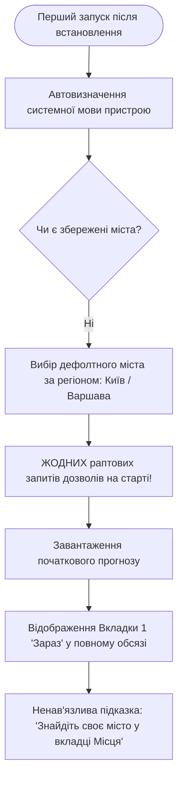
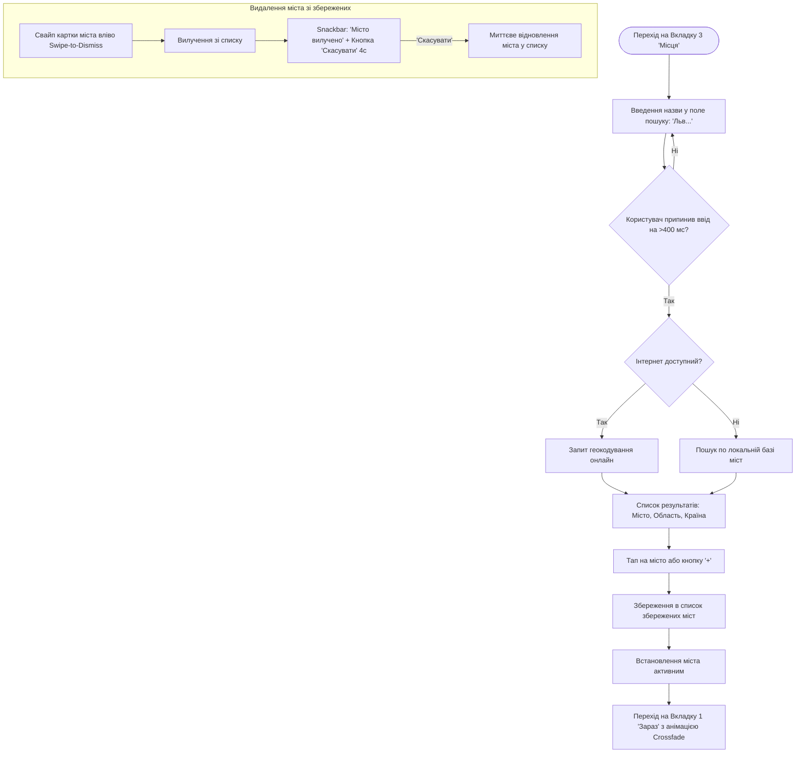
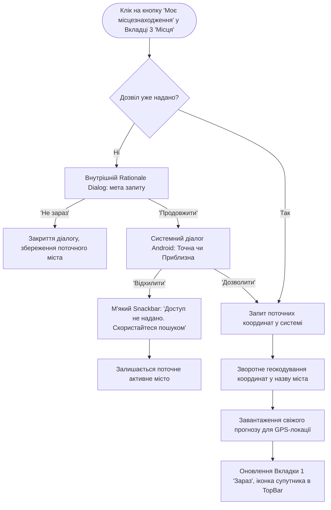
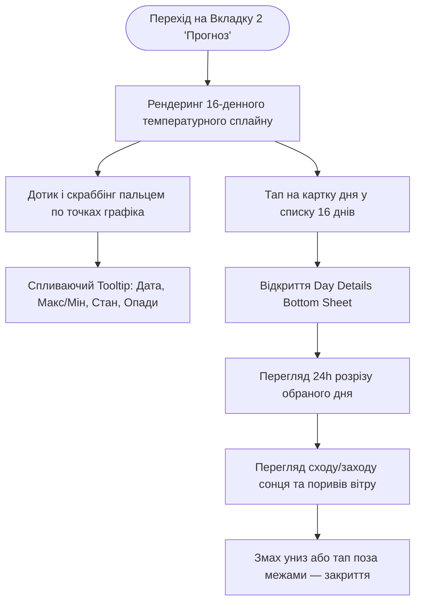
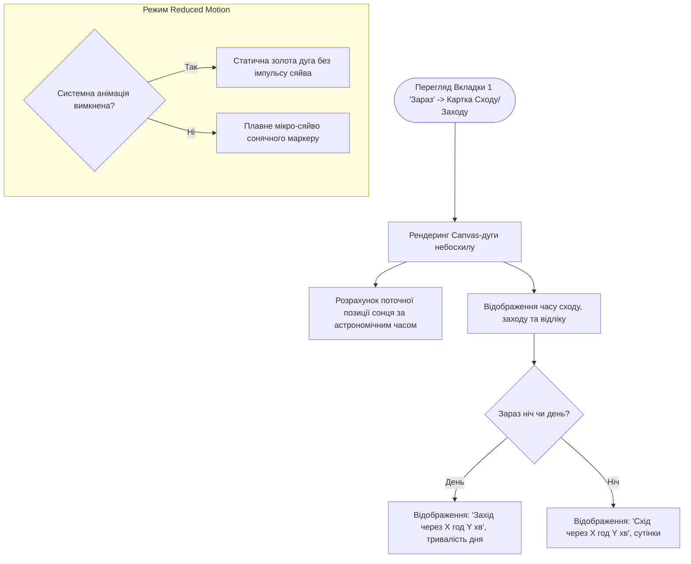
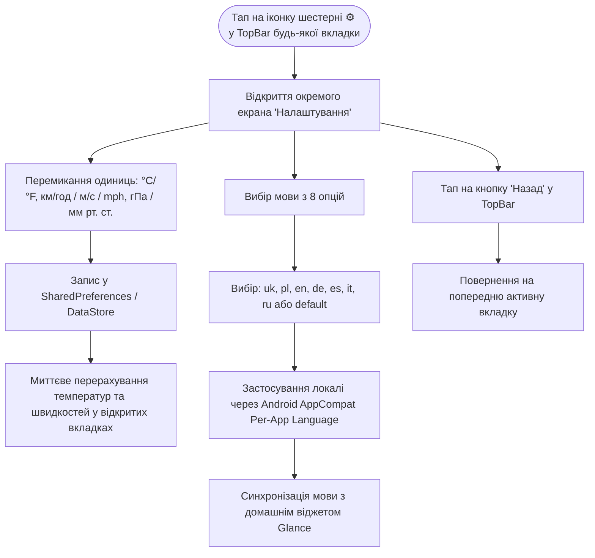
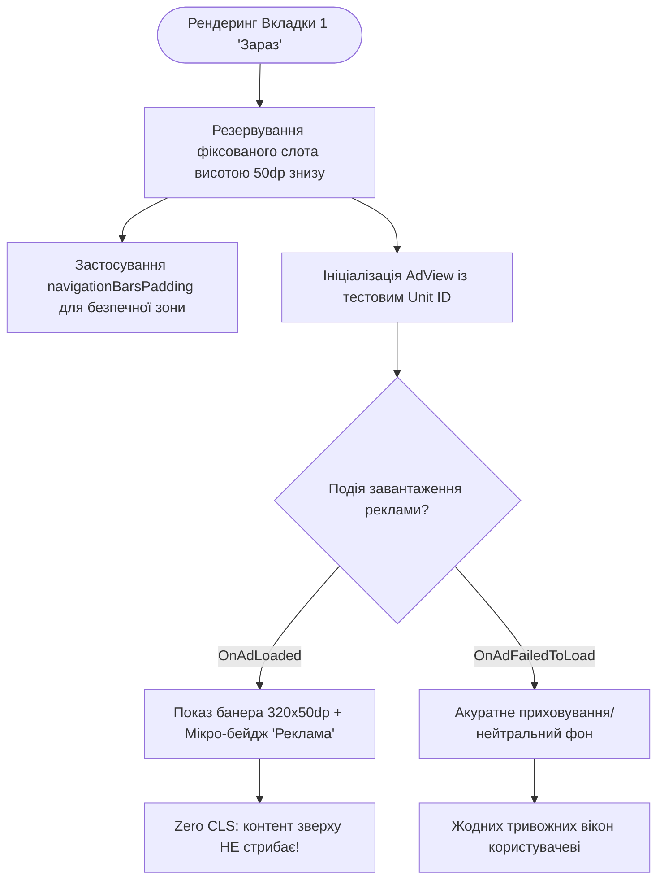

# Інформаційна архітектура та користувацькі сценарії (User Flows)
# Проєкт: «Weather — Smart Forecast» (v2.1)

> **Версія документа:** 2.1 (Phase 1 Design Corrections)  
> **Дата:** 2026-11-22  
> **Етап проєкту:** ROADMAP 2.0 — Phase 1: UX/UI Design  
> **Відповідальний автор:** Agent 1 (Product & UX Designer)  
> **Статус:** Підготовлено для незалежної верифікації (Ready for Review)  
> **Нормативна база:** Конституція v2.0, ADR-004 (GPS On-Demand), ADR-005 (Ad-Supported), ADR-006 (Material You), ADR-009 (Zero Budget Policy — $0), ADR-010 (WeatherMetro Free & 3-Section Architecture).

---

## 1. Загальна концепція та філософія взаємодії

Застосунок **«Weather — Smart Forecast»** проєктується як щоденний помічник користувача, що поєднує високу точність інформації, преміальну естетику **Google Material You & Glassmorphism**, сувору повагу до приватності та нульовий візуальний шум.

### Ключові принципи UX:
1. **Zero Intrusive Onboarding:** Застосунок запускається миттєво. Жодних нав'язливих діалогів, примусової реєстрації чи раптових запитів системних дозволів на старті.
2. **Glanceability (Зчитування з одного погляду):** Головна погодна інформація сприймається за 1-2 секунди без потреби скролу.
3. **Передбачуваність і прозорість (No Surprises & Privacy-First):** Геолокація активується виключно за явною дією користувача із попереднім прозорим поясненням мети запиту (Rationale). Фонове відстеження суворо заборонено.
4. **Контекстна глибина:** Інтерфейс пропонує дворівневе споживання даних — від загального статусу на головному екрані до інтерактивних графіків і щогодинного розбору кожного з 16 днів прогнозу.
5. **Zero CLS & повага до простору:** Рекламний банер зафіксований у безпечній зоні із зарезервованим розміром 50dp (відсутність стрибків контенту), а у віджетах реклама відсутня взагалі.
6. **Інклюзивність (Accessibility by Design, WCAG 2.1 AA):** Інтерфейс доступний для людей із порушеннями зору чи моторики (контраст ≥ 4.5:1, для великих чисел ≥ 3.0:1, тач-таргети ≥ 48x48dp, TalkBack, Dynamic Type до 200%, Reduced Motion).
7. **Ергономіка однієї руки (One-Handed Usability / Thumb Zone):**
   - Усі ключові інтерактивні елементи та щоденні дії розташовані в нижніх 60% висоти екрана («комфортна зона великого пальця» / Natural Thumb Zone).
   - Будь-яка основна дія (зміна міста, перегляд тренду, виклик деталей дня, перемикання розділу) досягається за 1–2 тапи без перехоплення смартфона.
   - Детальні дані відображаються у висувних Bottom Sheets, які легко змахуються донизу однією рукою.
8. **Чесність даних та відмова від псевдоімітацій (No Fake Data):** Оскільки наразі немає підтвердженого безкоштовного постачальника реальних погодних радарних тайлів або супутникових знімків опадів, процедурна імітація радара **виключена з MVP** і перенесена в беклог Post-MVP. Застосунок не дезінформує користувача штучно згенерованими даними.

---

## 2. Глобальна інформаційна архітектура застосунку

Застосунок організований навколо **трьох незалежних розділів (вкладок)** у нижній навігаційній панелі (Navigation Bar / Navigation Rail для широких екранів) та **окремого екрана «Налаштування»**, доступного через TopBar на всіх трьох вкладках:

```mermaid
flowchart TD
    AppLaunch([Запуск застосунку]) --> MainTabs{Нижня панель: 3 незалежні вкладки}
    
    MainTabs --> TabNow["Вкладка 1: Зараз (Dashboard)"]
    MainTabs --> TabForecast["Вкладка 2: Прогноз (16 Days & Trends)"]
    MainTabs --> TabPlaces["Вкладка 3: Місця (Saved Places & Search)"]
    
    TopBarActions["TopBar (присутній на всіх вкладках)"] --> SettingsIcon["Іконка шестерні (⚙️)"]
    SettingsIcon --> ScreenSettings["Окремий екран: Налаштування"]
    
    subgraph S1["Вкладка 1: «Зараз»"]
        TabNow --> HeroBlock["Hero-блок: Велика температура (84sp) + Погода + Min/Max"]
        TabNow --> HourlyRow["Погодинна стрічка 24h (від поточної години)"]
        TabNow --> MetricsGrid["Сітка 2x2: Вологість, Вітер, Тиск, УФ-індекс"]
        TabNow --> AstroArc["Canvas-дуга Сходу/Заходу Сонця + Відлік часу"]
        TabNow --> Attribution["Динамічна ліцензійна атрибуція джерела погоди"]
        TabNow --> AdMobBanner["AdMob банерний слот (50dp, Zero CLS)"]
    end
    
    subgraph S2["Вкладка 2: «Прогноз»"]
        TabForecast --> TempSpline["Інтерактивний сплайн-графік мін/макс 16 днів із скраббінгом"]
        TabForecast --> PrecipChart["Стовпчики опадів (мм та ймовірність %)"]
        TabForecast --> WindPressureTrends["Тренди швидкості вітру та тиску"]
        TabForecast --> Daily16List["16 карток днів із смужками амплітуди"]
        Daily16List --> DayDetailSheet["Bottom Sheet деталей обраного дня"]
    end
    
    subgraph S3["Вкладка 3: «Місця»"]
        TabPlaces --> CityCards["Список збережених міст з індикацією активного"]
        TabPlaces --> SearchBar["Швидкий пошук міст (онлайн + офлайн-база)"]
        TabPlaces --> QuickAdd["Швидке додавання міста у вибране (+)"]
        TabPlaces --> SwipeDismiss["Swipe-to-Dismiss видалення з 4с Undo"]
        TabPlaces --> GPSAction["Кнопка 'Моє місцезнаходження' (явний клік)"]
    end
    
    subgraph S4["Окремий екран: «Налаштування»"]
        ScreenSettings --> UnitToggles["Одиниці виміру: °C/°F, км/год / м/с / mph, гПа / мм рт. ст."]
        ScreenSettings --> LangSelector["Селектор 8 мов (uk, pl, en, de, es, it, ru, default)"]
        ScreenSettings --> LegalBlock["Юридична інформація, Privacy Policy, ліцензії"]
    end
```



---

## 3. Детальна специфікація трьох основних розділів та екрана налаштувань

### 3.1. Вкладка 1: «Зараз» (Current Weather & Daily Pulse)

Вкладка «Зараз» є першим екраном, який бачить користувач. Її завдання — миттєво відповісти на питання: *«Як одягатися просто зараз та чого чекати найближчими годинами?»*.

#### Склад екрана та анатомія компонентів:
1. **Верхня панель стану (Top Header Bar):**
   - Назва активного населеного пункту (HeadlineMedium, 20–22sp SemiBold).
   - Індикатор походження локації: іконка супутника для GPS або іконка шпильки для збереженого міста.
   - Поточна дата у локалізованому форматі (*«Неділя, 22 листопада»*).
   - Кнопка швидкого переходу в налаштування (іконка шестерні `Icons.Default.Settings`, тач-таргет 48x48dp).
2. **Hero-блок поточної погоди (Current Weather Hero):**
   - **Температура:** Домінуюча цифра (DisplayLarge, 84sp SemiBold/Bold) зі знаком градуса (°C / °F).
   - **Погодний статус:** Чіткий текст рідною мовою (*«Ясно»*, *«Мінлива хмарність»*, *«Помірний дощ»*).
   - **Відчувається як:** Розрахована еквівалентна температура з урахуванням вологості та вітру (*«Відчувається як -2°»*).
   - **Амплітуда доби:** Мінімальна та максимальна температура доби (*«↑ +4°  ↓ -3°»*).
   - **Індикатор свіжості (Data Freshness Badge):**
     - При свіжих даних (< 30 хв): текст дрібним шрифтом *«Оновлено о 14:15»*.
     - При застарілих даних (> 30 хв або в офлайні): помітний теплий бурштиновий чіп `Icons.Default.Schedule` *«Збережені дані від 11:20 (офлайн)»*.
3. **Погодинний ряд на 24 години (Hourly 24h Row):**
   - Розташований безпосередньо під Hero-блоком для безшовного переходу від поточного моменту до найближчого майбутнього.
   - Горизонтальний скрол із фіксацією старту від поточної години користувача.
   - Елемент години:
     - Час (*«Зараз»*, *«15:00»*, *«16:00»*...).
     - Векторна іконка погодного стану (28x28dp).
     - Температура на вказану годину.
     - Бейдж опадів (*«40%»* синім акцентом із мікрокраплею), якщо ймовірність перевищує 10%.
4. **Сітка ключових метрик (Key Metrics Grid 2x2):**
   - **Вологість повітря:** Значення у % (*78%*) із текстовою інтерпретацією рівня комфорту (*«Комфортно»*, *«Сухо»*, *«Волого»*).
   - **Вітер та пориви:** Швидкість у вибраних одиницях (км/год / м/с / mph), стрілка азимуту напрямку та максимальні пориви.
   - **Атмосферний тиск:** Подвійне або одинарне значення відповідно до налаштувань (гПа / мм рт. ст.), динамічний індикатор динаміки (росте/падає).
   - **УФ-індекс (UV Index):** Значення від 0 до 11+ з візуальною кольоровою смужкою безпеки та рекомендацією (*«Низький — захист не потрібен»*, *«Високий — захистіть очі та шкіру»*).
5. **Анімована дуга Сходу та Заходу Сонця (Sunrise & Sunset Canvas Card):**
   - Фізична Canvas-дуга небосхилу із золотистим градієнтним треком.
   - Сяюче сонце, положення якого на дузі точно відповідає поточному астрономічному часу.
   - Час сходу сонця (*07:18*) та час заходу (*16:05*).
   - Загальна тривалість світлового дня та зворотний таймер (*«Захід через 1 год 45 хв»* вдень або час до сходу вночі).
6. **Динамічна ліцензійна атрибуція джерела погоди:**
   - Делікатний напис у нижній частині контенту (*«Дані: WeatherMetro / Open-Meteo»*), що забезпечує 100% відповідність ліцензійним умовам безкоштовного API-договору.
7. **Google AdMob Banner Slot:**
   - Зафіксований нижній контейнер із зарезервованою висотою 50dp, Zero CLS.

---

### 3.2. Вкладка 2: «Прогноз» (Повний 16-денний прогноз, графіки та аналітика)

Вкладка «Прогноз» орієнтована на планування подій, поїздок та аналіз атмосферних тенденцій на повний підтримуваний API горизонт — **до 16 діб (384 години)**.

#### Склад екрана та анатомія компонентів:
1. **Інтерактивний температурний тренд (16-Day Spline Chart):**
   - Горизонтально скроловий або адаптивний дволінійний графік денних максимумів (червоно-помаранчева лінія) та нічних мінімумів (синьо-бірюзова лінія).
   - **Інтерактивний скраббінг (дотик пальцем):** при проведенні пальцем по графіку рухається вертикальний візир та відображається спливаюча мікро-картка (tooltip) із точною датою, температурами та погодним символом.
2. **Стовпчикова гістограма опадів (Precipitation Volume & Probability):**
   - Синхронізована за шкалою дат стовпчикова діаграма.
   - Висота стовпчика показує сумарну кількість опадів у міліметрах (мм).
   - Числовий бейдж відображає ймовірність дощу/снігу в % над стовпчиком (якщо > 15%).
3. **Тренди вітру та тиску (Atmospheric Dynamics Row):**
   - Горизонтальний ряд компактних чіпів, що візуалізують дні з різкими перепадами тиску (барометричні стрибки для метеозалежних людей) та дні зі штормовими поривами вітру > 45 км/год.
4. **16-денний структурований список (16-Day Forecast Cards):**
   - Вертикальний список із 16 карток днів (висота ≥ 52dp для доступного натискання):
     - Назва дня (*«Сьогодні»*, *«Завтра»*, *«Вт, 24 лист.»*).
     - Погодна піктограма високої чіткості.
     - Відсоток імовірності опадів (якщо > 10%).
     - **Смужка діапазону температур (Temperature Range Bar):** Горизонтальний кольоровий бар-градієнт, положення і довжина якого нормовані відносно екстремумів усього 16-денного вікна.
     - Числові показники мінімуму та максимуму (*«-2° ... +6°»*).
     - Шеврон виклику деталей дня.
5. **Розкриття деталей обраного дня (Day Details Bottom Sheet):**
   - При тапі на будь-яку картку списку відкривається деталізований Bottom Sheet:
     - 24-годинний погодинний розріз саме цього обраного дня.
     - Точна кількість опадів у мм рідкої води / снігу.
     - Максимальні пориви вітру та панівний напрямок.
     - Піковий ультрафіолетовий індекс доби.
     - Час сходу та заходу сонця для цієї дати.
     - Закриття свайпом донизу або тапом поза зоною.

---

### 3.3. Вкладка 3: «Місця» (Збережені міста, швидке додавання та пошук)

Вкладка «Місця» фокусується на швидкому керуванні списком локацій, оперативному пошуку та персоналізації.

#### Склад екрана та анатомія компонентів:
1. **Список збережених міст (Saved Places Cards):**
   - Картки збережених міст користувача (Київ, Варшава, Львів тощо).
   - Кожна картка показує: назву міста, країну/область, поточну температуру, погодну міні-іконку, позначку **«Активне»**.
   - Дії з містами:
     - Одинарний тап: миттєве перемикання активного міста для всього застосунку та повернення на вкладку «Зараз» із Crossfade-анімацією.
     - **Swipe-to-Dismiss:** свайп картки вліво вилучає місто зі збережених із показом захисного **Snackbar «Скасувати» (тривалість 4 секунди)**.
2. **Панель онлайн/офлайн швидкого пошуку населених пунктів:**
   - Поле пошуку з іконкою лупи, кнопкою швидкого очищення (хрестик) та плейсхолдером *«Пошук міста або села...»*.
   - **Розумне введення (Smart Query):**
     - Дебаунс 400 мс для оптимізації мережевих запитів.
     - При наявності інтернету: повнотекстовий пошук через онлайн-геокодер із зазначенням області, району та країни для уникнення неоднозначностей.
     - При відсутності інтернету: миттєвий пошук за вбудованою локальною базою ключових міст.
   - Кнопка **«+» (Швидке додавання)** навпроти кожного результату для додавання до збережених в один тап.
3. **Кнопка одноразової геолокації («Моє місцезнаходження»):**
   - Виділена картка або акцентна кнопка з іконкою `Icons.Default.MyLocation`.
   - Забезпечує миттєве визначення поточних координат користувача за явною дією (Zero Background Tracking).
   - Супроводжується прозорим Rationale Dialog перед викликом системного дозволу.

---

### 3.4. Окремий екран: «Налаштування» (Settings Screen)

Екран доступний через іконку шестерні у TopBar на всіх трьох вкладках.

#### Склад екрана та анатомія компонентів:
1. **TopBar екрана Налаштувань:** кнопка повернення «Назад» (`Icons.AutoMirrored.Filled.ArrowBack`), заголовок *«Налаштування»*.
2. **Блок одиниць виміру (Units of Measurement):**
   - **Температура:** перемикач (Segmented Button) — °C (Цельсій) / °F (Фаренгейт).
   - **Швидкість вітру:** вибір — км/год / м/с / mph.
   - **Атмосферний тиск:** вибір — гПа (гектопаскалі) / мм рт. ст. (міліметри ртутного стовпчика).
3. **Блок мови інтерфейсу (Language Selector — 8 опцій):**
   - Вибір мови з миттєвим перемиканням без перезапуску застосунку:
     - 🇺🇦 Українська (`uk`)
     - 🇵🇱 Польська (`pl`)
     - 🇬🇧 Англійська (`en`)
     - 🇩🇪 Німецька (`de`)
     - 🇪🇸 Іспанська (`es`)
     - 🇮🇹 Італійська (`it`)
     - 🇷🇺 Російська (`ru`)
     - 🌐 За замовчуванням системи (`default`)
4. **Юридична прозорість та ліцензії:**
   - Посилання на Політику конфіденційності (Privacy Policy).
   - Ліцензії стороннього відкритого програмного забезпечення (Open Source Licenses).
   - Інформація про версію застосунку та джерело даних (WeatherMetro Free / Open-Meteo).

---

### 3.5. Статус погодного радара: Беклог Post-MVP

> [!IMPORTANT]
> **Рішення щодо LIVE-радара:**  
> Оскільки в межах Zero Budget Policy ($0.00 витрат) наразі **немає підтвердженого безкоштовного джерела реальних радарних тайлів або супутникових знімків опадів**, розробка процедурної імітації («псевдорадара») **виключена з MVP**, щоб уникнути дезінформації користувачів.  
> Функціонал реального радіолокатора опадів зафіксований у беклозі **Post-MVP** і буде реалізований після появи валідного відкритого джерела радарних даних або відповідного стратегічного рішення Власника.

---

## 4. Повні користувацькі сценарії (User Flows 1–9)

### Flow 1: Перший запуск застосунку (Zero-Intrusive Onboarding)



- **Мета користувача:** Миттєво побачити актуальну погоду без обов'язкових форм, реєстрацій та запитів дозволів.
- **Поведінка системи:**
  1. Жодних блокуючих вікон локації чи нотифікацій.
  2. Завантажується місто за замовчуванням для регіону (Київ або Варшава).
  3. Користувач одразу отримує робочий екран із погодою на добу, метриками та графіком сходу сонця.

---

### Flow 2: Пошук населених пунктів, швидке додавання та видалення з 4с Undo



- **Мета користувача:** Знайти потрібне місто чи село за пару секунд, додати до обраних та легко керувати списком.
- **Поведінка системи:**
  1. Дебаунс 400 мс захищає мережу та безкоштовну квоту API.
  2. Результати показують район/область для точної ідентифікації населеного пункту.
  3. Видалення супроводжується захисним механізмом: 4-секундний Snackbar «Скасувати» повертає елемент на своє місце.

---

### Flow 3: Одноразовий запит геолокації («Моє місцезнаходження»)



- **Мета користувача:** Отримати прогноз у точці фактичного перебування за одне натискання.
- **Поведінка системи (Strict Privacy Compliance):**
  1. Запит координат відбувається **лише за явною дією користувача**.
  2. Rationale Dialog попереджає про мету запиту. Підтримуються як Coarse, так і Fine дозволи.
  3. Відсутність фонового відстеження гарантує нульовий розряд акумулятора.

---

### Flow 4: Робота з 16-денним прогнозом та інтерактивним скраббінгом



- **Мета користувача:** Оцінити температурну амплітуду найближчих двох тижнів та детально вивчити конкретний день.
- **Поведінка системи:**
  1. Графік сплайну реагує на проведення пальцем без лагів (60 fps).
  2. Виклик Bottom Sheet деталей дня дозволяє переглянути щогодинний прогноз будь-якого дня без перезавантажень сторінки.

---

### Flow 5: Астрономічний цикл та сонячна дуга (Daylight & Solar Cycle Inspection)



- **Мета користувача:** Дізнатися тривалість світлового дня та точний час сходу/заходу сонця для планування прогулянок, фотографії чи подорожей.
- **Поведінка системи:**
  1. Canvas-дуга фізично відображає підйом та опускання сонця на горизонті.
  2. У режимі Reduced Motion анімація сяйва вимикається, зберігаючи точні статичні значення.
  3. *(Примітка: Радар перенесено в беклог Post-MVP до підтвердження реального джерела радарних тайлів).*

---

### Flow 6: Екран налаштувань: зміна одиниць виміру та вибір мови (8 опцій)



- **Мета користувача:** Налаштувати звичні одиниці виміру, мову інтерфейсу та ознайомитися з ліцензіями.
- **Поведінка системи:**
  1. Доступ до екрана здійснюється з будь-якої точки застосунку через верхню панель.
  2. Зміна одиниць та мови відбувається «на льоту» без скидання стану та без втрати збережених міст.

---

### Flow 7: Домашні віджети на робочому столі Android (2x2 та 4x2)

```mermaid
flowchart TD
    AddWidget([Додавання віджета на робочий стіл]) --> ChooseSize{Вибір розміру: 2x2 чи 4x2}
    
    ChooseSize -- Компактний 2x2 --> Init2x2[Відображення: Місто, Температура, Стан, Min/Max]
    ChooseSize -- Розширений 4x2 --> Init4x2[Відображення: Поточна погода + 4 дні міні-прогнозу]
    
    Init2x2 --> ReadCache[Миттєвий показ із дискового кешу без очікування мережі]
    Init4x2 --> ReadCache
    
    ReadCache --> ScheduleAlarm[Реєстрація періодичного фонового оновлення AlarmManager (10–15 хв)]
    
    ScheduleAlarm --> AlarmTrigger[Спрацювання таймера оновлення]
    AlarmTrigger --> FetchWidgetData[Легкий фоновий запит для активного міста]
    FetchWidgetData --> UpdateGlance[Оновлення RemoteViews віджета Glance]
    
    subgraph ClickWidget["Клік по віджету"]
        TapWidget[Тап на віджет користувачем] --> OpenApp[Відкриття застосунку на вкладці 'Зараз']
    end
```

- **Мета користувача:** Бачити актуальну погоду на головному екрані без відкриття застосунку.
- **Поведінка системи:**
  1. Jetpack Glance із підкладкою Glassmorphism (радіус 28dp, сапфірово-грифельний градієнт).
  2. **Zero Advertising у віджетах:** реклама у віджетах повністю заборонена.
  3. Відсутність безперервних анімацій забезпечує 0% паразитного розходу батареї.

---

### Flow 8: Офлайн-режим та стійкість до збоїв мережі чи HTTP 429

```mermaid
flowchart TD
    TriggerRefresh([Оновлення: Відкриття / Pull-to-Refresh]) --> CheckConnection{Чи є інтернет-з'єднання?}
    
    CheckConnection -- Ні (Офлайн) --> CheckCache{Чи є закешований прогноз?}
    CheckCache -- Так --> ShowCachedWeather[Показ закешованого прогнозу]
    ShowCachedWeather --> AmberBadge[Відображення теплого бурштинового бейджа: 'Дані від 12:40 (офлайн)']
    ShowCachedWeather --> OfflineSearchAvail[Пошук перемикається на локальну вбудовану базу міст]
    
    CheckCache -- Ні --> FullErrorScreen[Екран помилки: 'Немає з'єднання' + Кнопка 'Спробувати знову']
    
    CheckConnection -- Так (Мережа є) --> SendAPIReq[Запит до Weather API]
    SendAPIReq --> HandleResponse{Код відповіді сервера?}
    
    HandleResponse -- 200 OK --> SuccessSave[Оновлення UI + Запис свіжих даних у кеш]
    
    HandleResponse -- 429 Too Many Requests --> RateLimitHandler[Виявлення перевищення ліміту запитів]
    RateLimitHandler --> ShowStaleFallback[Показ останнього кешу + SnackBar: 'Сервер зайнятий. Спробуйте через хвилину']
    RateLimitHandler --> Backoff[Експоненційне сповільнення повторних запитів]
```

- **Мета користувача:** Мати безперервний доступ до прогнозу навіть без зв'язку (у літаку, метро, роумінгу).
- **Поведінка системи:**
  1. Усі дані зберігаються на диск. При збоях відображається останній надійний прогноз із міткою часу.
  2. При HTTP 429 застосунок плавно сповільнює виклики, не блокуючи роботу користувача.

---

### Flow 9: Google AdMob банерний слот (Zero CLS)



- **Мета користувача:** Користуватися якісним безкоштовним сервісом без агресивних спливаючих банерів, що перекривають інтерфейс.
- **Поведінка системи:**
  1. Фіксована висота контейнера усуває зсув макета (CLS = 0).
  2. Банер присутній лише на головній вкладці. У віджетах, Bottom Sheets та діалогах реклама суворо відсутня.

---

## 5. Ергономіка однієї руки (One-Handed Usability & Thumb Zone)

Для забезпечення максимального комфорту щоденного використання в русі розроблено карту доступності зон екрана для великого пальця (Thumb Zone):

```
+-----------------------------+
|        TopBar: ⚙️           |  <- Зона дотягування (рідкісні дії: Налаштування)
|      (Місто, Дата, ⚙️)      |
+-----------------------------+
|                             |
|      Hero-температура       |  <- Зона візуального огляду (Glance Area)
|          (84sp)             |     Не потребує частих натискань
|                             |
+-----------------------------+
|   Погодинний ряд 24h        |
+-----------------------------+  -- Початок Natural Thumb Zone (нижні 60% екрана)
|   Сітка метрик 2x2          |
+-----------------------------+  <- Зона комфортного доступу великого пальця:
|   Дуга сходу/заходу сонця   |     - Скрол контенту
+-----------------------------+     - Скраббінг графіка на Вкладці 2
|   AdMob банер (50dp)        |     - Виклик Bottom Sheet деталей дня
+=============================+     - Швидке додавання міст на Вкладці 3
|   [Зараз] [Прогноз] [Місця] |  <- Нижня навігаційна панель (миттєвий тап)
+-----------------------------+
```

### Принципи реалізації One-Handed Usability:
1. **Нижня панель навігації:** Перемикання між трьома вкладками («Зараз», «Прогноз», «Місця») здійснюється в один тап у найзручнішій нижній зоні.
2. **Bottom Sheets замість нових екранів:** Деталізація погоди на обраний день відкривається у нижньому висувному вікні, де вся ключова інформація розташована під великим пальцем і закривається простим змахуванням донизу.
3. **Швидкі дії на Вкладці «Місця»:** Кнопка «Моє місцезнаходження», список збережених міст та кнопка швидкого додавання розташовані в зоні швидкої досяжності.
4. **Рідкісні дії вгорі:** Налаштування (шестерня) та інформація про місто винесені у верхній бар, що захищає від випадкових натискань під час навігації.

---

## 6. Критерії доступності (Accessibility Acceptance Criteria — WCAG 2.1 AA)

| Критерій доступності | Вимога стандарту | Реалізація в інтерфейсі застосунку | Спосіб перевірки |
|---|---|---|---|
| **Контрастність тексту** | WCAG 2.1 AA (≥ 4.5:1 для тексту, ≥ 3.0:1 для великих чисел) | Усі текстові елементи на градієнтних погодних фонах мають контрастність від 4.6:1 до 9.2:1. Для напівпрозорих бейджів застосовується темна захисна підкладка. | Автоматичні тести кольорів та Compose Accessibility Checker. |
| **Мінімальні тач-таргети** | Мінімум 48x48dp для будь-якого клікабельного елемента | Усі кнопки дій (GPS, вкладки навігації, шестерня налаштувань, картки міст, рядки списку) мають розмір зони натискання щонайменше 48x48dp із відступами не менше 8dp між таргетами. | Compose Accessibility Test / Layout Inspector. |
| **Семантика для TalkBack** | Повне словесне озвучення для всіх графічних елементів | Кожна погодна іконка має `contentDescription` рідною мовою (*«Мінлива хмарність, без опадів»*). Графіки мають альтернативний текстовий опис у списку днів. | Свайп-навігація з увімкненим TalkBack. |
| **Масштабування Dynamic Type** | Підтримка збільшення системного шрифту до 200% | Текстові контейнери використовують гнучкі розміри (`wrap_content`), переноси рядків або вертикальний скрол; заборонено фіксувати висоту карток у dp для текстових блоків. | Android Settings -> Display -> Font Size (200%). |
| **Режим Reduced Motion** | Повага до системного налаштування вимкнення анімацій | Перевірка `TRANSITION_ANIMATION_SCALE`: дуга сонця стає статичною, замість Shimmer використовується статичний плейсхолдер, переходи вкладок спрощуються до швидкого Cut/Fade 50 мс. | Developer Options -> Animator duration scale = 0. |

---

## 7. Дотримання політики $0 Zero Budget та цілісність контрактів

1. **Zero Budget Policy ($0.00 витрат):**
   - Усі UX-рішення реалізуються нативними компонентами Android Jetpack Compose та системними Canvas API.
   - Заборона будь-яких платних API чи картографічних SDK. Виключення псевдорадара усуває ризик неякісного користувацького досвіду без додаткових витрат.
2. **Незмінність доменних та API контрактів:**
   - Архітектура повністю відповідає моделям `WeatherInfo`, `DailyForecast`, `HourlyForecast`, `LocationCoordinates`.
   - Всі 16 днів прогнозу та погодинний ряд беруться з вихідного контракту без додаткових запитів чи модифікації бізнес-логіки.

---

## 8. Матриця граничних станів (Edge Cases & System Reactions)

| Сценарій / Стан | Поведінка інтерфейсу для користувача | Дія для відновлення |
|---|---|---|
| **Пошук населеного пункту, якого не існує** | Екран списку показує дружню ілюстрацію та текст: *«Населений пункт не знайдено. Перевірте правильність написання»*. | Очистити рядок пошуку або ввести іншу назву. |
| **Користувач двічі поспіль натискає 'Відхилити' GPS** | Застосунок запам'ятовує статус відмови, не показує настирливих вікон і пропонує скористатися пошуком міста вручну. | Скористатися рядком пошуку або відкрити налаштування Android за бажанням. |
| **Повна відсутність інтернету при першому запуску** | Застосунок відкриває дефолтне місто з попередньо збереженої локальної БД із позначкою офлайну. | Підключитися до Wi-Fi / мобільного інтернету та зробити Pull-to-Refresh. |
| **Перевищення квоти викликів API (HTTP 429)** | Користувач продовжує бачити актуальні закешовані дані; знизу з'являється SnackBar: *«Сервер тимчасово зайнятий. Відображаються останні збережені дані»*. | Автоматичний повтор запиту через експоненційну паузу (2, 4, 8 сек). |
| **Швидке перемикання між містами у збережених** | Плавний перехід із Crossfade анімацією (150 мс); відсутність мерехтіння завдяки локальному кешу для кожного збереженого міста. | Миттєвий перегляд збережених прогнозів. |
| **Випадкове видалення міста зі списку** | Свайп картки видаляє місто, але знизу з'являється 4-секундний Snackbar із кнопкою *«Скасувати»*. | Тап на *«Скасувати»* миттєво повертає місто на попередню позицію. |
