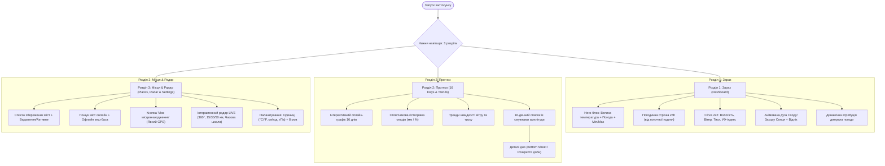
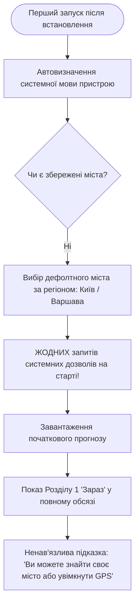
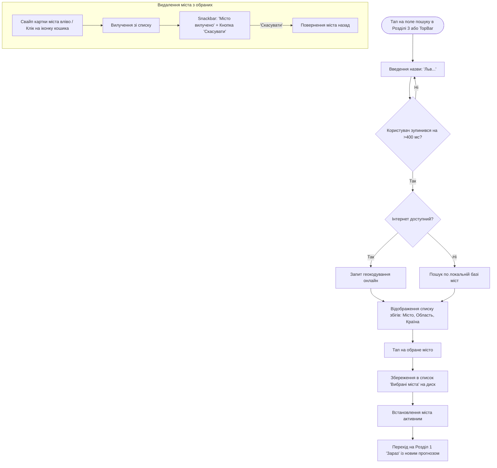
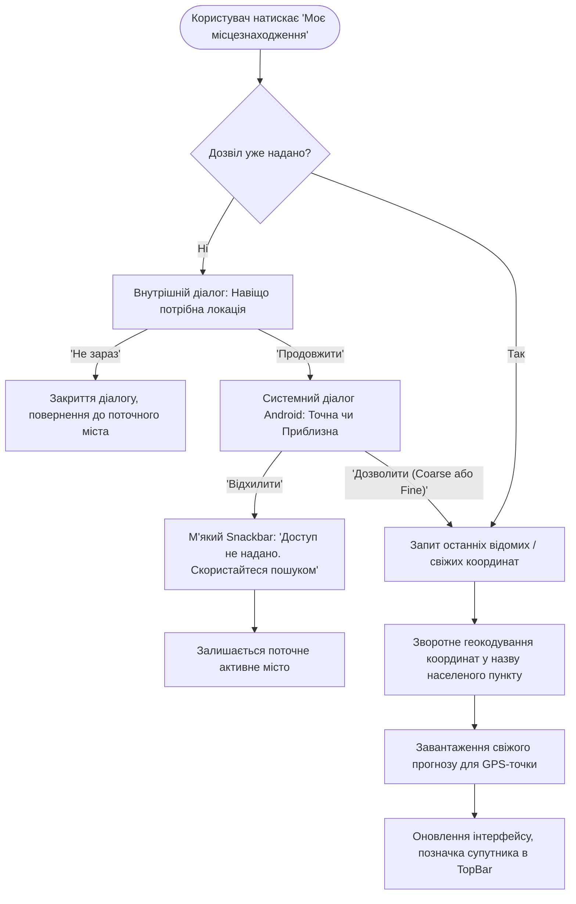
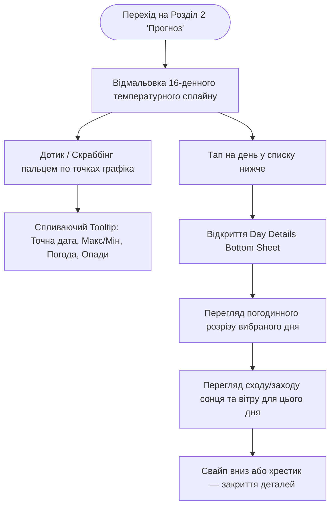
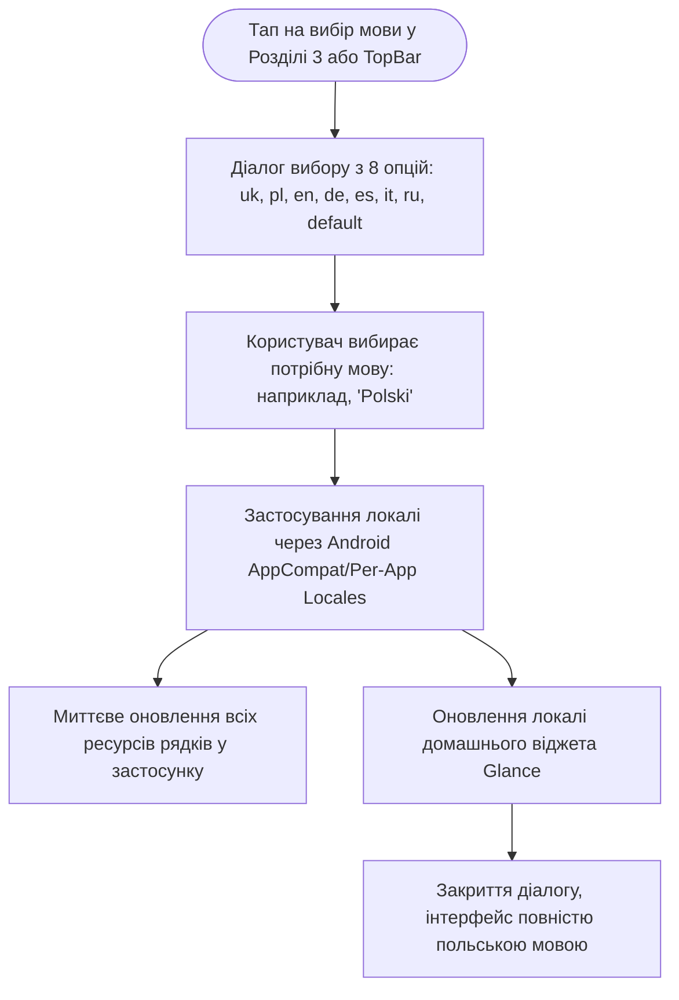
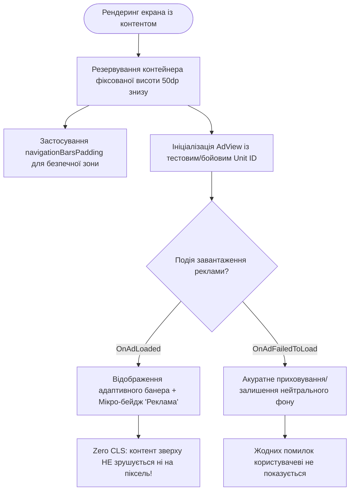

# Інформаційна архітектура та користувацькі сценарії (User Flows)
# Проєкт: «Weather — Smart Forecast» (v2.0)

> **Версія документа:** 2.0  
> **Дата:** 2026-11-22  
> **Етап проєкту:** ROADMAP 2.0 — Phase 1: UX/UI Design  
> **Відповідальний автор:** Agent 1 (Product & UX Designer)  
> **Статус:** Підготовлено для незалежної верифікації (Ready for Review)  
> **Нормативна база:** Конституція v2.0, ADR-004 (GPS On-Demand), ADR-005 (Ad-Supported), ADR-006 (Material You), ADR-009 (Zero Budget Policy), ADR-010 (WeatherMetro Free & 3-Section Architecture).

---

## 1. Загальна концепція та філософія взаємодії

Застосунок **«Weather — Smart Forecast»** проєктується як щоденний супутник користувача, що поєднує високу інформативність, преміальну естетику **Google Material You & Glassmorphism**, сувору повагу до приватності та відсутність візуального шуму.

### Ключові принципи UX:
1. **Zero Intrusive Onboarding:** Застосунок запускається миттєво. Жодних нав'язливих діалогів, примусової реєстрації чи раптових запитів системних дозволів на старті.
2. **Glanceability (Зчитування з одного погляду):** Головна погодна інформація сприймається за 1-2 секунди без потреби скролу.
3. **Передбачуваність і прозорість (No Surprises):** Геолокація активується виключно за явним кліком користувача із попереднім прозорим поясненням мети запиту.
4. **Контекстна глибина:** Інтерфейс пропонує дворівневе споживання даних — від загального статусу на головному екрані до інтерактивних графіків і щогодинного розбору кожного з 16 днів прогнозу.
5. **Zero CLS & повага до простору:** Рекламний банер зафіксований у безпечній зоні із зарезервованим розміром (відсутність стрибків контенту), а у віджетах реклама відсутня взагалі.
6. **Інклюзивність (Accessibility by Design):** Інтерфейс доступний для людей із порушеннями зору чи моторики (WCAG 2.1 AA, контраст ≥ 4.5:1, тач-таргети ≥ 48dp, TalkBack, Reduced Motion).

---

## 2. Глобальна інформаційна архітектура застосунку

Застосунок організований навколо **трьох головних функціональних розділів**, доступних через нижню навігаційну панель (Navigation Bar / Navigation Rail для широких екранів):



---

## 3. Детальна специфікація трьох основних розділів

### 3.1. Розділ 1: «Зараз» (Current Weather & Daily Pulse)

Розділ «Зараз» є першим екраном, який бачить користувач. Його завдання — миттєво відповісти на питання: *«Як одягатися просто зараз та чого чекати найближчими годинами?»*.

#### Склад екрана та анатомія компонентів:
1. **Верхня панель стану (Top Header Bar):**
   - Назва активного населеного пункту (HeadlineMedium, 22sp SemiBold).
   - Індикатор походження локації: іконка супутника/стрілки для GPS або іконка шпильки для вручну обраного міста.
   - Поточна дата у локалізованому форматі (наприклад, *«Неділя, 22 листопада»*).
   - Кнопка швидкого оновлення даних (Pull-to-Refresh жестом або кнопка при TalkBack).
2. **Hero-блок поточної погоди (Current Weather Hero):**
   - **Температура:** Домінуюча цифра (DisplayLarge, 72–84sp Bold) зі знаком градуса (°C / °F).
   - **Погодний статус:** Чіткий текст рідною мовою (наприклад: *«Ясно»*, *«Мінлива хмарність»*, *«Помірний дощ»*).
   - **Відчувається як:** Розрахована еквівалентна температура з урахуванням вологості та вітру (*«Відчувається як -2°»*).
   - **Амплітуда доби:** Мінімальна та максимальна температура доби (*«↑ +4°  ↓ -3°»*).
   - **Індикатор свіжості (Data Freshness Badge):**
     - При свіжих даних (< 30 хв): текст дрібним шрифтом *«Оновлено о 14:15»*.
     - При застарілих даних (> 30 хв або в офлайні): помітний теплий бурштиновий чіп `Icons.Default.Schedule` *«Збережені дані від 11:20 (офлайн)»*.
3. **Погодинний прогноз на 24 години (Hourly 24h Carousel):**
   - Розташований безпосередньо під Hero-блоком для безшовного переходу від поточного моменту до найближчого майбутнього.
   - Горизонтальний скрол із фіксацією старту від поточної години користувача.
   - Елемент години:
     - Час (*«Зараз»*, *«15:00»*, *«16:00»*...).
     - Векторна іконка погодного стану (28x28dp).
     - Температура на вказану годину.
     - Бейдж опадів (*«40%»* синім акцентом із мікрокраплею), якщо ймовірність перевищує 10%.
4. **Сітка ключових метрик (Key Metrics Grid 2x2):**
   - **Вологість повітря:** Значення у % (наприклад, *78%*) із текстовою інтерпретацією рівня комфорту (*«Комфортно»*, *«Сухо»*, *«Волого»*).
   - **Вітер та пориви:** Швидкість у км/год (або м/с), стрілка азимуту напрямку та максимальні пориви.
   - **Атмосферний тиск:** Подвійне відображення в гПа та мм рт. ст. (наприклад: *1018 гПа / 764 мм*), динамічний індикатор динаміки (росте/падає).
   - **УФ-індекс (UV Index):** Значення від 0 до 11+ з візуальною кольоровою смужкою безпеки та рекомендацією (*«Низький — захист не потрібен»*, *«Високий — захистіть очі та шкіру»*).
5. **Анімована дуга Сходу та Заходу Сонця (Sunrise & Sunset Canvas Card):**
   - Фізична Canvas-дуга небосхилу із золотистим градієнтним треком.
   - Сяюче сонце, положення якого на дузі точно відповідає поточному астрономічному часу.
   - Час сходу сонця (наприклад, *07:18*) та час заходу (наприклад, *16:05*).
   - Загальна тривалість світлового дня та зворотний таймер (*«Захід через 1 год 45 хв»* вдень або час до сходу вночі).
6. **Динамічна атрибуція джерела погоди:**
   - Делікатний напис у нижній частині контенту (наприклад: *«Дані: WeatherMetro / Open-Meteo»*), що забезпечує 100% відповідність ліцензійним умовам безкоштовного API-договору.
7. **Google AdMob Banner Slot:**
   - Зафіксований нижній контейнер із зарезервованою висотою 50dp, Zero CLS.

---

### 3.2. Розділ 2: «Прогноз» (16-Day Forecast, Charts & Trends)

Розділ «Прогноз» орієнтований на планування подій, поїздок та аналіз атмосферних тенденцій на повний підтримуваний API горизонт — **до 16 діб (384 години)**.

#### Склад екрана та анатомія компонентів:
1. **Інтерактивний температурний тренд (16-Day Spline Chart):**
   - Горизонтально скроловий або адаптивний дволінійний графік денних максимумів (червоно-помаранчева лінія) та нічних мінімумів (синьо-бірюзова лінія).
   - Інтерактивний скраббінг (дотик пальцем): при переміщенні пальця по графіку відображається спливаюча мікро-картка (tooltip) із точною датою, температурами та погодним символом.
2. **Стовпчикова гістограма опадів (Precipitation Volume & Probability):**
   - Синхронізована за шкалою дат стовпчикова діаграма.
   - Висота стовпчика показує сумарну кількість опадів у міліметрах (мм).
   - Кольорове насичення або накладений числовий бейдж відображає ймовірність дощу/снігу в %.
3. **Тренди вітру та тиску (Atmospheric Dynamics Row):**
   - Горизонтальний ряд компактних чіпів, що візуалізують дні з різкими перепадами тиску (барометричні стрибки для метеозалежних людей) та дні зі штормовими поривами вітру > 45 км/год.
4. **16-денний структурований список (16-Day Forecast List):**
   - Вертикальний список із 16 рядків, де кожен день містить:
     - Назву дня (*«Сьогодні»*, *«Завтра»*, *«Вт, 24 лист.»*).
     - Погодну піктограму високої чіткості.
     - Відсоток імовірності опадів (якщо > 10%).
     - **Смужку діапазону температур (Temperature Range Bar):** Горизонтальний кольоровий бар-градієнт, положення і довжина якого нормовані відносно екстремумів усього 16-денного вікна.
     - Числові показники мінімуму та максимуму (*«-2° ... +6°»*).
     - Шеврон або індикатор розкриття.
5. **Розкриття деталей обраного дня (Day Details Expansion):**
   - При тапі на будь-який день списку відкривається деталізований Bottom Sheet або акордеонний блок:
     - 24-годинний погодинний розріз саме цього обраного дня.
     - Точна кількість опадів у мм рідкої води / снігу.
     - Максимальні пориви вітру та панівний напрямок.
     - Піковий ультрафіолетовий індекс доби.
     - Час сходу та заходу сонця для цієї дати.

---

### 3.3. Розділ 3: «Місця & Радар» (Places, Radar & Settings)

Розділ об'єднує просторовий контроль, оперативну картографію погоди та користувацькі персоналізації.

#### Склад екрана та анатомія компонентів:
1. **Управління збереженими містами (Saved Places Management):**
   - Список карток збережених міст користувача (наприклад: Київ, Варшава, Львів).
   - Кожна картка показує: назву міста, країну/область, поточну температуру, погодну міні-іконку, позначку «Активне».
   - Дії з містами:
     - Одинарний тап: миттєве перемикання активного міста для всього застосунку та повернення/перехід на прогноз.
     - Свайп картки вліво (Swipe-to-Dismiss) або кнопка видалення: вилучення міста зі збережених із можливістю швидкого скасування (Snackbar «Скасувати»).
2. **Панель онлайн/офлайн пошуку населених пунктів:**
   - Поле пошуку з іконкою лупи, кнопкою швидкого очищення (хрестик) та плейсхолдером *«Пошук міста або села...»*.
   - **Розумне введення (Smart Query):**
     - Дебаунс 400 мс для оптимізації мережевих запитів.
     - При наявності інтернету: повнотекстовий пошук через онлайн-геокодер.
     - При відсутності інтернету: миттєвий пошук за вбудованою локальною базою ключових міст.
     - Результати містять точну назву, район/область та країну для уникнення неоднозначностей.
3. **Кнопка одноразової геолокації («Моє місцезнаходження»):**
   - Виділена картка або акцентна кнопка з іконкою `MyLocation`.
   - Забезпечує миттєве визначення поточних координат користувача за явною дією (Zero Background Tracking).
4. **Інтерактивний погодний радар LIVE (Weather Radar 360°):**
   - Круглий Canvas-локатор із центром у вибраному місті.
   - **Концентричні кола масштабу:** кільця 15 км, 30 км та 50 км дальності.
   - **360° скануючий sweep-промінь:** плавний обертовий радіальний градієнт, що створює відчуття живого спостереження.
   - **Чотирирівнева шкала опадів:**
     1. Мряка (світло-зелений/блакитний).
     2. Помірний дощ (синій).
     3. Сильна злива (фіолетовий).
     4. Гроза/град (яскраво-бурштиновий / червоний).
   - **Часова шкала (Timeline Slider):** повзунок перегляду опадів від -2 годин (історія) через поточний момент до +1 години (наукастинг / прогноз переміщення хмар).
   - Кнопка **Play / Pause** для автоматичної циклічної анімації руху фронту.
5. **Блок персоналізації та системних налаштувань:**
   - **Одиниці вимірювання:**
     - Температура: °C (Цельсій) / °F (Фаренгейт).
     - Вітер: км/год / м/с / mph.
     - Тиск: гПа / мм рт. ст. / inHg.
   - **Вибір мови інтерфейсу (8 опцій):**
     - Українська (`uk`), Польська (`pl`), Англійська (`en`), Німецька (`de`), Іспанська (`es`), Італійська (`it`), Російська (`ru`) та Системна за замовчуванням (`default`).
   - **Юридична прозорість:** Посилання на Політику конфіденційності, ліцензії відкритого ПЗ та версію застосунку.

---

## 4. Повні користувацькі сценарії (User Flows 1–9)

### Flow 1: Перший запуск застосунку (Zero-Intrusive Onboarding)



- **Мета користувача:** Миттєво побачити погоду без проходження довгих онбордингів та без надання персональних даних.
- **Поведінка системи:**
  1. Застосунок не показує жодних діалогових вікон запиту локації чи сповіщень.
  2. Мова інтерфейсу підтягується із системної локалі смартфона (якщо це одна з 7 підтримуваних мов, інакше англійська).
  3. Як стартове місто завантажується Київ (для української локалі) або Варшава/столиця регіону з бази за замовчуванням.
  4. Користувач одразу отримує повноцінний інтерфейс із температурою, погодинним рядом та сіткою метрик.

---

### Flow 2: Пошук міст та сіл, додавання та видалення з обраного



- **Мета користувача:** Швидко знайти будь-яке місто чи село, переглянути прогноз та зберегти його у вибране.
- **Поведінка системи:**
  1. Під час введення запиту використовується 400 мс дебаунс для уникнення надлишкових запитів.
  2. Результати чітко розрізняють однойменні населені пункти, вказуючи область та країну.
  3. Вибране місто зберігається локально у `SharedPreferences` / кеш.
  4. Видалення з обраного супроводжується захисним механізмом Undo через Snackbar (тривалість 4 секунди).

---

### Flow 3: Одноразове визначення геолокації за кнопкою («Моє місцезнаходження»)



- **Мета користувача:** Отримати точний прогноз у точці свого перебування без постійного стеження у фоні.
- **Поведінка системи (Strict Privacy Compliance):**
  1. Жодного запиту без прямого кліку.
  2. Перед викликом Android API з'являється прозорий Rationale Dialog: *«Дозвіл потрібен лише для прогнозу в цьому місці. Ми не відстежуємо вас у фоні»*.
  3. Підтримується як `Approximate` (Coarse), так і `Precise` (Fine) — для погоди підходять обидва.
  4. Заборонено запитувати `ACCESS_BACKGROUND_LOCATION`.

---

### Flow 4: Робота з графіками прогнозу на 16 днів



- **Мета користувача:** Зрозуміти загальний тренд потепління/похолодання на 2 тижні вперед та спланувати активності.
- **Поведінка системи:**
  1. Графік будується плавною кривою Безьє без гострих заломів.
  2. Всі точки доступні для зчитування скрінрідером TalkBack через альтернативні текстові описи рядків списку.
  3. Деталізація будь-якого з 16 днів розкриває повні показники без перезавантаження сторінки.

---

### Flow 5: Інспекція погодного радара та астрономічних даних

```mermaid
flowchart TD
    NavRadar([Перехід до Розділу 3 'Місця & Радар' -> Блок Радара]) --> LoadRadarCanvas[Ініціалізація Canvas радара з кільцями 15/30/50 км]
    LoadRadarCanvas --> StartSweep[Запуск плавного 360° обертання скануючого променя]
    
    LoadRadarCanvas --> UserDragSlider[Користувач переміщує повзунок часу (-2h ... +1h)]
    UserDragSlider --> UpdateRainPositions[Зміна положення хмарних кластерів опадів на радіальній сітці]
    
    LoadRadarCanvas --> TogglePlay[Натискання кнопки Play / Pause]
    TogglePlay -- Pause --> StopAnimation[Зупинка обертання, статичний зріз опадів]
    TogglePlay -- Play --> ResumeAnimation[Циклічне відтворення руху фронту]
```

- **Мета користувача:** Побачити наближення дощового фронту на карті та перевірити положення сонця.
- **Поведінка системи:**
  1. Радар рендериться на апаратно-прискореному Canvas із підтримкою 60 fps.
  2. При ввімкненому системному налаштуванні **Reduced Motion** автоматичний рух вимикається: радар стає чітким статичним зрізом опадів із ручним керуванням повзунком.

---

### Flow 6: Перемикання мови інтерфейсу (8 мов)



- **Мета користувача:** Користуватися застосунком рідною або зручною для нього мовою.
- **Поведінка системи:**
  1. Підтримуються 7 мовних пакетів + опція системної мови за замовчуванням (разом 8 опцій).
  2. Зміна мови відбувається на льоту без втрати поточного стану перегляду та збережених міст.
  3. Віджет робочого столу отримує оновлену локаль під час наступного циклу оновлення.

---

### Flow 7: Встановлення та поведінка віджетів на домашньому екрані (2x2, 4x2)

```mermaid
flowchart TD
    AddWidget([Додавання погодного віджета на робочий стіл Android]) --> ChooseSize{Вибір розміру: 2x2 чи 4x2}
    
    ChooseSize -- Компактний 2x2 --> Init2x2[Відображення: Місто, Температура, Стан, Min/Max]
    ChooseSize -- Розширений 4x2 --> Init4x2[Відображення: Поточна погода + 4-денний міні-прогноз]
    
    Init2x2 --> ReadLocalCache[Миттєвий рендеринг з WeatherLocalCache без очікування мережі]
    Init4x2 --> ReadLocalCache
    
    ReadLocalCache --> ScheduleAlarm[Реєстрація періодичного фонового оновлення через AlarmManager (10-15 хв)]
    
    ScheduleAlarm --> AlarmTrigger[Спрацювання таймера оновлення]
    AlarmTrigger --> FetchWidgetData[Легкий запит погодних даних для збереженого міста]
    FetchWidgetData --> UpdateGlance[Оновлення RemoteViews віджета]
    
    subgraph ClickWidget["Взаємодія з віджетом"]
        TapWidget[Тап на віджет користувачем] --> OpenApp[Відкриття застосунку на обраному місті]
    end
```

- **Мета користувача:** Бачити актуальну погоду прямо на головному екрані смартфона без відкриття застосунку.
- **Поведінка системи:**
  1. Використовується Jetpack Glance із підкладкою Glassmorphism (заокруглення 28dp, сапфірово-грифельний градієнт).
  2. Первинний рендеринг відбувається миттєво з дискового кешу.
  3. **Сувора відсутність покадрової анімації та реклами:** віджет повністю чистий від рекламних блоків, що гарантує 0% паразитного розряду батареї.

---

### Flow 8: Офлайн-робота та реакція на збої мережі або HTTP 429

```mermaid
flowchart TD
    TriggerRefresh([Запуск оновлення: Відкриття / Pull-to-Refresh]) --> CheckConnection{Чи є з'єднання з інтернетом?}
    
    CheckConnection -- Ні (Офлайн) --> CheckCache{Чи є збережений кеш на диску?}
    CheckCache -- Так --> ShowCachedWeather[Показ закешованої погоди]
    ShowCachedWeather --> AmberBadge[Відображення бурштинового бейджа: 'Дані від 12:40 (офлайн)']
    ShowCachedWeather --> OfflineSearchAvail[Пошук міст перемикається на локальну базу]
    
    CheckCache -- Ні --> FullErrorScreen[Центральний екран: 'Немає з'єднання' + Кнопка 'Спробувати знову']
    
    CheckConnection -- Так (Мережа є) --> SendAPIReq[Запит до Weather API]
    SendAPIReq --> HandleResponse{Код відповіді сервера?}
    
    HandleResponse -- 200 OK --> SuccessSave[Оновлення UI + Запис свіжих даних у кеш]
    
    HandleResponse -- 429 Too Many Requests --> RateLimitHandler[Виявлення перевищення ліміту запитів]
    RateLimitHandler --> ShowStaleFallback[Показ останнього кешу + Повідомлення: 'Сервер тимчасово зайнятий. Спробуйте за хвилину']
    RateLimitHandler --> Backoff[Експоненційне сповільнення повторних запитів]
```

- **Мета користувача:** Мати безперервний доступ до прогнозу навіть у літаку, метро чи під час тимчасових перебоїв зв'язку.
- **Поведінка системи:**
  1. Кеш зберігається персистентно на диску.
  2. Якщо запит завершується помилкою (немає мережі або HTTP 429 / 5xx), користувач не бачить порожнього білого екрана — відображається останній надійний кеш із чіткою міткою часу.

---

### Flow 9: Слот банера Google AdMob у нижній частині (Zero CLS)



- **Мета користувача:** Отримувати безкоштовний сервіс без агресивної, випадкової реклами, що перекриває кнопки або зміщує текст у момент читання.
- **Поведінка системи:**
  1. Контейнер банера має суворо фіксовану висоту (Zero Cumulative Layout Shift).
  2. Реклама розміщена виключно внизу головного вікна із дотриманням відступів системних жестів.
  3. У віджетах робочого столу, спливаючих діалогах та Bottom Sheet реклама суворо заборонена.

---

## 5. Критерії доступності (Accessibility Acceptance Criteria — WCAG 2.1 AA)

| Критерій доступності | Вимога стандарту | Реалізація в інтерфейсі застосунку | Спосіб перевірки |
|---|---|---|---|
| **Контрастність тексту** | WCAG 2.1 AA (≥ 4.5:1 для звичайного тексту, ≥ 3.0:1 для великого тексту ≥18sp) | Усі текстові елементи на градієнтних погодних фонах мають контрастність від 4.6:1 до 9.2:1. Для напівпрозорих бейджів використовується темна підкладка із захистом від розмиття. | Перевірка аналізатором контрасту та автоматичними тестами кольорів. |
| **Мінімальні тач-таргети** | Мінімум 48x48dp для будь-якого клікабельного елемента | Усі кнопки дій (GPS, Пошук, Вибір мови, Навігація, Шеврони днів) мають розмір зони натискання щонайменше 48x48dp із відступами не менше 8dp між сусідніми таргетами. | Compose Accessibility Test / Layout Inspector. |
| **Семантика для TalkBack** | Повне словесне озвучення для всіх нетекстових елементів | Кожна погодна іконка має `contentDescription` рідною мовою (наприклад: *«Мінлива хмарність, без опадів»* замість *«хмара»*). Графіки мають альтернативний текстовий опис у списку днів. | Ручне тестування зі свайп-навігацією TalkBack. |
| **Масштабування Dynamic Type** | Підтримка збільшення системного шрифту до 200% | Текстові контейнери використовують гнучкі розміри (`wrap_content`), обмеження максимальних рядків із багатокрапкою або вертикальний скрол; заборонено фіксувати висоту карток у dp для текстових блоків. | Перевірка в Android Settings -> Display -> Font Size (Maximum). |
| **Режим Reduced Motion** | Повага до системного налаштування відключення анімацій | Перевірка `LocalContext` або `Settings.Global.TRANSITION_ANIMATION_SCALE`: при увімкненому Reduced Motion вимикається обертання радара, дуга сонця стає статичною, замість Shimmer використовується статичний плейсхолдер. | Перевірка в Developer Options -> Animator duration scale = 0. |

---

## 6. Дотримання політики $0 Zero Budget та цілісність контрактів

1. **Zero Budget Policy ($0.00 витрат):**
   - Усі UX-рішення використовують безкоштовні нативні компоненти Android Jetpack Compose та системні Canvas API.
   - Жодних сторонніх платних картографічних підкладок (Google Maps API чи Mapbox SDK не використовуються; погодний радар побудовано на процедурному векторному Canvas із безкоштовною геометрією).
2. **Незмінність доменних та API контрактів:**
   - Інформаційна архітектура повністю відповідає існуючим моделям: `WeatherInfo`, `DailyForecast`, `HourlyForecast`, `LocationCoordinates`.
   - Всі 16 днів прогнозу беруться безпосередньо з вихідного контракту без додаткових запитів.

---

## 7. Матриця граничних станів (Edge Cases & System Reactions)

| Сценарій / Стан | Поведінка інтерфейсу для користувача | Дія для відновлення |
|---|---|---|
| **Пошук населеного пункту, якого не існує** | Екран списку показує дружню ілюстрацію та текст: *«Населений пункт не знайдено. Перевірте правильність написання»*. | Очистити рядок або ввести іншу назву. |
| **Користувач двічі поспіль натискає 'Відхилити' GPS** | Застосунок запам'ятовує статус відмови, не показує настирливих вікон і пропонує: *«Ви можете скористатися пошуком міста вручну»*. | Скористатися рядком пошуку або відкрити налаштування Android за бажанням. |
| **Повна відсутність інтернету при першому запуску** | Застосунок відкриває дефолтне місто з попередньо збереженої локальної БД із позначкою офлайну. | Підключитися до Wi-Fi / мобільного інтернету та зробити Pull-to-Refresh. |
| **Перевищення квоти викликів API (HTTP 429)** | Користувач продовжує бачити актуальні закешовані дані; зверху з'являється м'який SnackBar: *«Сервер тимчасово зайнятий. Відображаються останні збережені дані»*. | Автоматичний повтор запиту через експоненційну паузу (2, 4, 8 сек). |
| **Швидке перемикання між містами у збережених** | Плавний перехід із Crossfade анімацією (150 мс); відсутність мерехтіння чи білих екранів завдяки локальному кешу для кожного збереженого міста. | Миттєвий перегляд збережених прогнозів. |
