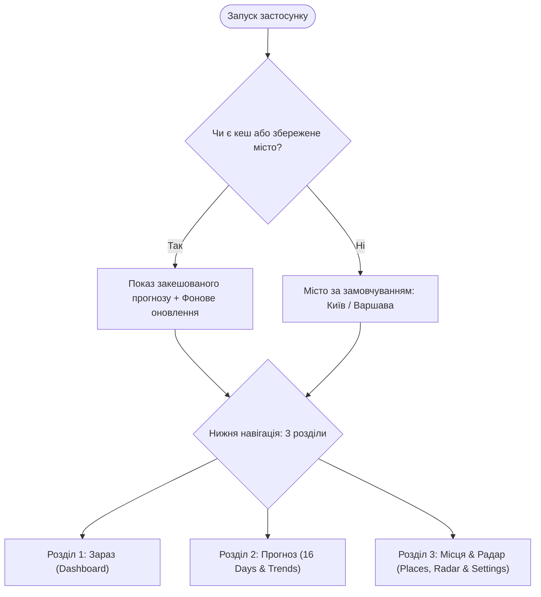

# UX-специфікація застосунку «Weather — Smart Forecast» (v2.0)

> **Версія документа:** 2.0  
> **Дата:** 2026-11-22  
> **Відповідальний агент:** `product-ux` (Agent 1)  
> **Статус:** Підготовлено для незалежної верифікації (Phase 1 — UX/UI Design)  
> **Відповідність ADR:** ADR-004 (Геолокація за запитом), ADR-005 (Рекламна модель), ADR-006 (Стиль Material You & назва), ADR-009 (Zero Budget Policy — $0 витрат), ADR-010 (WeatherMetro Free та архітектура 3 розділів).

---

## 1. Загальна концепція та продуктове бачення

Застосунок **«Weather — Smart Forecast»** («Погода») — це швидкий, надійний та естетичний Android-застосунок, побудований на принципах сучасного дизайну **Google Material You (Material 3)** та **Glassmorphism**. Продукт орієнтований на міжнародну аудиторію та вирішує завдання миттєвого інформування про поточну погоду, надання деталізованого 16-денного прогнозу (384 години), оперативної радіолокації опадів та комфортного керування обраними містами за нульового бюджету ($0.00).

### Ключові дизайн-принципи:
1. **Миттєве зчитування (Glanceability):** Головні показники (температура, погодні явища, денна амплітуда) мають найбільшу візуальну вагу та зчитуються за 1–2 секунди.
2. **Трьохроздільна структура навігації:** Логічне розділення інтерфейсу на три спеціалізовані розділи: **«Зараз»**, **«Прогноз»** та **«Місця & Радар»**.
3. **Атмосферне занурення:** 7 процедурних погодних атмосфер неба (ясно, хмарно, дощ, сніг, гроза, туман, ніч) із плавними градієнтами, адаптованими до світлої та темної тем.
4. **Повна доступність (Accessibility-First, WCAG 2.1 AA):** Контрастність тексту ≥ 4.5:1 (для великих чисел ≥ 3.0:1), тач-таргети ≥ 48x48dp, семантичні описи всіх компонентів для TalkBack та підтримка масштабування шрифту до 200%.
5. **Повага до приватності та автономність:** Локація запитується виключно за явною ініціативою користувача. Відсутність GPS не обмежує пошук і роботу застосунку. Прихований або фоновий трекінг суворо заборонений.
6. **Делікатна монетизація (Zero CLS):** Рекламний банер AdMob закріплений у нижній частині контенту у фіксованому контейнері 50dp без зсуву макета (Cumulative Layout Shift = 0). У віджетах робочого столу реклама суворо відсутня.

---

## 2. Глобальна інформаційна архітектура

Інтерфейс застосунку базується на нижній панелі навігації (`NavigationBar` у портретній орієнтації або `NavigationRail` на планшетах) із трьома основними напрямками:

---

## 3. Детальна специфікація трьох основних розділів

### 3.1. Розділ 1: «Зараз» (Поточний стан та найближчі години)

Головний дашборд оперативного погодного стану для обраного міста.

#### Анатомія компонентів:
1. **Верхня панель (Top App Bar):**
   - Назва поточного міста (HeadlineMedium, 22sp SemiBold).
   - Індикатор походження геопозиції (піктограма GPS-супутника або шпильки для міста зі списку).
   - Поточна дата у локалізованому форматі (наприклад: *«Неділя, 22 листопада»*).
   - Кнопка швидкого оновлення даних (Pull-to-Refresh жест або дія для TalkBack).
2. **Hero-блок поточної погоди (Current Weather Hero):**
   - **Температура:** Домінуюча цифра (DisplayLarge, 72–84sp Bold) зі знаком градуса (°C / °F).
   - **Погодний стан:** Чіткий текст рідною мовою (наприклад: *«Ясно»*, *«Помірний дощ»*, *«Суцільна хмарність»*).
   - **Відчувається як:** Розрахована еквівалентна температура з урахуванням вологості та вітру (*«Відчувається як -2°»*).
   - **Діапазон доби:** Мінімальна та максимальна температура доби (*«↑ +4°  ↓ -3°»*).
   - **Статус свіжості даних (Timestamp & Stale Badge):**
     - Свіжі дані (< 30 хв): текст дрібним шрифтом *«Оновлено сьогодні о 14:15»*.
     - Застарілі дані (> 30 хв або офлайн): помітний бурштиновий чіп `Icons.Default.Schedule` *«Збережені дані від 11:20 (офлайн)»*.
3. **Погодинний прогноз на 24 години (Hourly Forecast Row):**
   - Горизонтальна карусель, розташована безпосередньо під Hero-блоком.
   - Початок фіксується від поточної години користувача.
   - Елемент години містить: час (*«Зараз»*, *«15:00»*...), погодну піктограму 28dp, температуру та бейдж опадів (*«40%»* синім кольором із краплею при > 10%).
4. **Панель ключових метрик (Key Metrics Grid 2x2):**
   - **Вологість:** Значення у % (наприклад: *74%*) з оцінкою комфорту (*«Комфортно»*, *«Волого»*).
   - **Вітер:** Швидкість у км/год (або м/с), напрямок зі стрілкою азимуту та максимальні пориви.
   - **Атмосферний тиск:** Подвійне значення у гПа та мм рт. ст. (наприклад: *1014 гПа / 761 мм*).
   - **УФ-індекс:** Градація від 0 до 11+ з візуальним кольоровим індикатором безпеки.
5. **Анімована дуга Сходу та Заходу Сонця (Sunrise & Sunset Card):**
   - Canvas-дуга небосхилу із золотистим градієнтом.
   - Динамічне положення сонця за реальним часом.
   - Час сходу, заходу, загальна тривалість світлового дня та зворотний відлік (*«Захід через 2 год 15 хв»*).
6. **Динамічна атрибуція джерела:**
   - Ненав'язливий текстовий рядок унизу: *«Дані: WeatherMetro / Open-Meteo»* (відповідно до умов API та ліцензії).
7. **Рекламний банер AdMob (нижній слот):**
   - Фіксована висота 50dp, Zero CLS, відступ системної панелі навігації.

---

### 3.2. Розділ 2: «Прогноз» (16-денний горизонт, графіки та аналітика)

Розділ глибокого планування та аналізу атмосферних тенденцій на повний горизонт до 16 днів.

#### Анатомія компонентів:
1. **Інтерактивний сплайн-графік температур (16-Day Spline Chart):**
   - Дволінійна крива Безьє: червоно-помаранчева (денні максимуми) та синьо-бірюзова (нічні мінімуми).
   - Інтерактивний скраббінг пальцем із спливаючим Tooltip: точна дата, екстремуми та погодні явища.
2. **Стовпчикова гістограма опадів (Precipitation Column Chart):**
   - Стовпчики об'єму опадів у мм рідкої води / снігу.
   - Числовий відсоток ймовірності опадів над кожним стовпчиком при > 15%.
3. **Тренди швидкості вітру та тиску:**
   - Чіпи барометричних коливань (попередження для метеочутливих людей) та дні зі штормовим вітром.
4. **16-денний список прогнозу (Daily Forecast List):**
   - 16 інтерактивних рядків (висота ≥ 52dp для доступності).
   - Смужка амплітуди температур (Temperature Range Bar) із відносною нормалізацією до загального 16-денного діапазону.
   - Тап відкриває модальне вікно або акордеон деталей обраного дня.
5. **Деталізація обраного дня (Day Details Bottom Sheet):**
   - 24-годинний погодинний розріз вибраного дня.
   - Сумарні опади, пориви вітру, УФ-пік, вологість та астрономічний таймінг дня.

---

### 3.3. Розділ 3: «Місця & Радар» (Управління містами, LIVE-радар та персоналізація)

Розділ просторового огляду та тонких налаштувань користувача.

#### Анатомія компонентів:
1. **Управління збереженими містами (Saved Places Management):**
   - Список карток збережених міст із температурою, станом та позначкою активного.
   - Тап — перемикання активного міста; свайп уліво — вилучення зі списку з можливістю скасування (Snackbar Undo).
2. **Панель онлайн/офлайн пошуку міст:**
   - Поле пошуку з автодебаунсом 400 мс.
   - Онлайн-геокодування населених пунктів із зазначенням області/країни.
   - Автоматичний фолбек на вбудовану локальну базу міст при відсутності інтернет-з'єднання.
3. **Кнопка «Моє місцезнаходження» (GPS за явною дією):**
   - Прозорий Rationale Dialog перед викликом дозволів Android.
   - Підтримка як Coarse (приблизні), так і Fine (точні) координат.
   - Захист приватності: нуль фонового трекінгу, жодних витоків координат.
4. **Інтерактивний погодний радар LIVE (360° Sweep Radar):**
   - Процедурний круговий Canvas із кільцями дальності 15/30/50 км.
   - 360° обертовий sweep-промінь із градієнтною розгорткою.
   - 4 рівні інтенсивності опадів (мряка, дощ, злива, гроза).
   - Часова шкала (Timeline Slider) від -2 годин до +1 години із кнопкою Play/Pause.
5. **Налаштування застосунку:**
   - Перемикач одиниць виміру (°C / °F, км/год / м/с / mph, гПа / мм рт. ст. / inHg).
   - Селектор мови з 8 опціями: `uk`, `pl`, `en`, `de`, `es`, `it`, `ru` та системна за замовчуванням (`default`).
   - Посилання на Політику конфіденційності та ліцензії.

---

## 4. Специфікація станів інтерфейсу (UI States)

| Стан | Візуальне відображення | Доступність TalkBack | Reduced Motion поведінка |
|---|---|---|---|
| **Loading (Завантаження)** | Shimmer-скелетон для Hero, погодинного ряду та карток. Плавний біжучий градієнт. | Оголошення: *«Завантаження погодних даних»*. | Статичний напівпрозорий блок без анімації хвилі. |
| **Success (Успіх)** | Повний контент із погодним градієнтом неба, реальними цифрами та графіками. | Оголошення: *«Погода у місті [Назва]: [Температура], [Стан]»*. | Миттєва поява або короткий Crossfade 100 мс. |
| **Offline / Stale (Офлайн із кешем)** | Показ закешованих даних із бурштиновим бейджем: *«Офлайн-режим. Дані від [Час]»*. | Оголошення: *«Офлайн-режим. Показано збережені дані»*. | Статичний бейдж без пульсації. |
| **Error (Помилка без кешу)** | Центральна ілюстрація, текст *«Немає з'єднання»*, велика кнопка *«Спробувати знову»* (48dp). | Фокус переноситься на помилку та кнопку повтору. | Миттєве відображення без перехідних ефектів. |
| **Rate Limited (HTTP 429)** | Показ останнього кешу + м'який SnackBar: *«Сервер тимчасово перевантажений. Спробуйте пізніше»*. | Озвучення попередження без переривання навігації. | Стандартне повідомлення. |

---

## 5. Домашній віджет (Jetpack Glance AppWidget)

### Вимоги та обмеження:
- **Zero Advertising:** Реклама у віджетах суворо заборонена правилами Google Play та внутрішньою політикою проєкту.
- **Енергоефективність:** Оновлення кожні 10–15 хвилин через `AlarmManager.setAndAllowWhileIdle`; заборона покадрових безперервних анімацій.
- **Дизайн:** Glassmorphism підкладка з радіусом 28dp, сапфірово-грифельний градієнт 135° та біла світлова окантовка 1dp.
- **Розміри:**
  1. **Компактний (2x2):** місто, температура, погодна іконка, денний діапазон.
  2. **Розширений (4x2):** ліва колонка — поточна погода з метриками; права колонка — 4-денний міні-прогноз з відсотком опадів.

---

## 6. Критерії доступності (WCAG 2.1 AA)

1. **Контрастність:** Мінімальний коефіцієнт контрастності для основного тексту становить 4.5:1, для великих температурних показників — 3.0:1.
2. **Тач-таргети:** Усі кнопки, перемикачі та елементи списків мають розмір зони взаємодії не менше 48x48dp.
3. **Семантика:** Усі іконки, графічні смужки та точки графіків мають описові `contentDescription` мовою користувача.
4. **Dynamic Type:** Інтерфейс коректно адаптується при системному збільшенні шрифту до 200% без обрізання тексту.
5. **Reduced Motion:** При увімкненому системному режимі зменшення руху вимикаються автоматичні обертання радара, дуги сонця та хвилі Shimmer.
