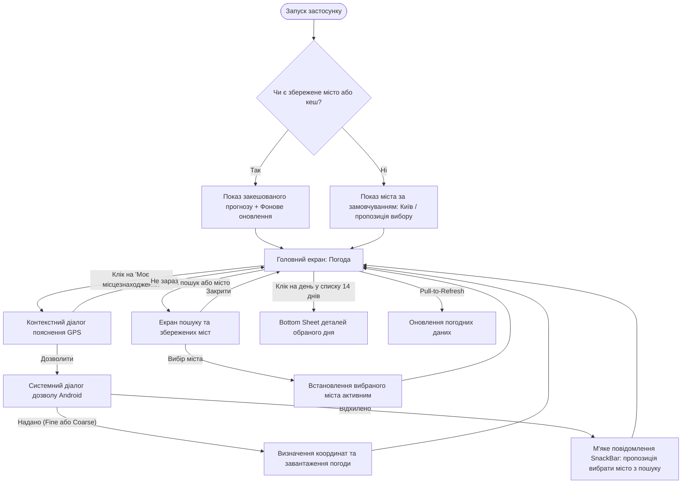

# UX-специфікація застосунку «Погода» (Weather)

> **Версія документа:** 1.0  
> **Дата:** 2026-11-17  
> **Відповідальний агент:** `product-ux`  
> **Статус:** Затверджено для реалізації (Фаза 1)  
> **Відповідність ADR:** ADR-004 (Геолокація), ADR-005 (Реклама), ADR-006 (Стиль Material You та назва)

---

## 1. Загальна концепція та продуктове бачення

Застосунок **«Погода»** — це надійний, естетичний та легкий Android-застосунок, побудований на принципах сучасного дизайну **Google Material You (Material 3)**. Головна мета продукту — надати користувачеві вичерпну інформацію про поточну погоду, погодинний прогноз на 24 години та надійний щоденний прогноз на 14 днів із першого погляду, мінімізуючи когнітивне навантаження та забезпечуючи комфортне сприйняття за будь-яких умов освітлення.

### Ключові дизайн-принципи:
1. **Миттєве зчитування (Glanceability):** Головні показники (температура, опади, стан неба) мають найбільшу візуальну вагу й доступні без додаткових кліків.
2. **Атмосферне занурення:** Фон інтерфейсу м'яко відображає стан неба (ясно, дощ, хмарність, гроза, сніг, ніч) через гармонійні градієнти, що адаптуються до темної/світлої теми системи.
3. **Повна доступність (Accessibility-First):** Відповідність стандартам WCAG 2.1 AA (контраст не менше 4.5:1 для тексту), мінімальні зони натискання 48x48dp, семантичні описи всіх піктограм для TalkBack та масштабування тексту до 200%.
4. **Повага до приватності та автономність:** Локація запитується виключно за явною ініціативою користувача. Відсутність GPS не обмежує пошук і роботу застосунку.
5. **Делікатна монетизація:** Рекламний блок акуратно інтегрований у нижню частину контенту, не зміщує критичні погодні показники (CLS = 0) і маркується зрозумілою плашкою. У системному віджеті реклама відсутня.

---

## 2. Інформаційна архітектура та карта переходів

### 2.1. Діаграма навігаційних станів (User Flow)

---

## 3. Детальна специфікація екранів та компонентів

### 3.1. Головний екран (Weather Dashboard)

Головний екран є вертикально скроловим полотном, адаптованим до жестів свайпу (Pull-to-Refresh) та динамічної висоти екрана.

#### 1. Верхня панель (Top App Bar):
- **Лівий елемент:** Кнопка меню міст (іконка списку/пошуку `Icons.Default.Menu` або `Icons.Default.LocationCity`, таргет 48x48dp, contentDescription: *"Список міст та пошук"*).
- **Центральний елемент:**
  - Назва поточного міста (HeadlineMedium, наприклад: «Київ», «Львів»).
  - Індикатор типу геопозиції (піктограма супутника/стрілки для GPS або піктограма шпильки для вручну обраного міста).
- **Правий елемент:** Кнопка «Моє місцезнаходження» (`Icons.Default.MyLocation`, таргет 48x48dp, contentDescription: *"Визначити погоду за моїм місцезнаходженням"*).

#### 2. Блок поточної погоди (Hero Current Weather Card):
- **Температура:** Великий чіткий числовий показник (DisplayLarge, 64–72sp) зі знаком градуса (°C).
- **Погодний стан:**
  - Текстовий статус українською мовою (наприклад: «Сонячно», «Здебільшого хмарно», «Помірний дощ»).
  - Відчувається як (Apparent Temperature, наприклад: «Відчувається як +18°»).
- **Діапазон дня:** Мінімальна та максимальна температура на сьогодні (наприклад: «↑ 22°  ↓ 14°»).
- **Статус свіжості даних (Timestamp & Stale Indicator):**
  - Якщо дані оновлені нещодавно (< 30 хв): «Оновлено сьогодні о 14:15».
  - Якщо дані застаріли (> 30 хв або офлайн): Жовтуватий/нейтральний чіп-бейджик `Icons.Default.Schedule` *"Дані від 11:20 (можуть бути застарілі)"*.

#### 3. Панель додаткових погодних метрик (Weather Parameters Grid):
Сітка з 4 карток або 2x2 компонентів з округленими кутами (16dp):
- **Вологість:** Піктограма краплі, значення у % (наприклад: *74%*), рівень комфорту (*«Комфортно»* або *«Волого»*).
- **Вітер:** Піктограма флюгера/вітру, швидкість у км/год (наприклад: *14 км/год*), стрілка напрямку вітру.
- **Тиск:** Піктограма барометра, значення у гПа (гектопаскалях) та мм рт. ст. (наприклад: *1014 гПа*).
- **Ультрафіолетовий індекс (UV Index):** Значення від 0 до 11+ з текстовою градацією безпеки (наприклад: *3 — Помірний*, *6 — Високий, потрібен захист*).

#### 4. Погодинна стрічка (Hourly 24h Forecast Carousel):
- Горизонтальний ряд із фіксацією початку з поточної години.
- Елемент години містить:
  - Час (наприклад: «Зараз», «16:00», «17:00», LabelSmall).
  - Контрастну векторну іконку стану неба (28x28dp) із повним текстовим описом для TalkBack.
  - Температуру на цю годину (+19°).
  - Ймовірність опадів у % (наприклад, «60%» синім кольором із мікропіктограмою краплі), якщо ймовірність перевищує 10%. Якщо 0–10% — поле залишається порожнім для зменшення візуального шуму.

#### 5. Список прогнозу на 14 днів (14-Day Forecast List):
- Вертикальний список із 14 рядків у контейнері з м'якою підкладкою.
- Кожен рядок (висота не менше 52dp для доступності) відображає:
  1. **День:** «Сьогодні», «Завтра», або трилітерне скорочення дня тижня з датою (наприклад: *«Ср, 19 лист.»*).
  2. **Іконка:** Погодна умова дня.
  3. **Ймовірність опадів:** Текстовий відсоток (наприклад: *45%*).
  4. **Смужка діапазону температур (Temperature Range Bar):** Горизонтальний бар, де положення та ширина кольорового градієнта відповідають min/max цього дня відносно абсолютного мінімуму та максимуму за всі 14 днів.
  5. **Числа температур:** «+12° ... +21°».
  6. **Клікабельність:** Натискання на рядок відкриває деталі обраного дня (Bottom Sheet).

#### 6. Рекламний блок (Ad Banner Slot):
- **Розташування:** Нижня частина екрана (під списком 14 днів у скроловому контейнері або зафіксований знизу адаптивний банер із відступом безпечної зони `navigationBarsPadding()`).
- **Маркування:** Обов'язкова мікроплашка «Реклама» / «Ad» висотою 14dp відповідно до політик Google AdMob.
- **Поведінка:**
  - Розмір: Стандартний адаптивний банер (320x50dp або 360x60dp) або Native Card.
  - Якщо реклама завантажується: показується акуратний контейнер фіксованої висоти, запобігаючи стрибкам контенту (CLS = 0).
  - Якщо реклама не завантажилася або відсутній інтернет: рекламний слот безпечно згортається без повідомлень про помилку.
  - Жодних перекриттів системних жестів навігації або погодних кнопок.

---

### 3.2. Екран деталей обраного дня (Day Details Bottom Sheet)

Викликається тапом на будь-який день у списку 14-денного прогнозу.

- **Формат:** Modal Bottom Sheet з можливістю свайпу вниз для закриття та кнопкою закриття `X` угорі праворуч.
- **Вміст:**
  - Заголовок: Назва дня та дата (наприклад, *«П'ятниця, 21 листопада»*).
  - Стан: Велика погодна піктограма, текстовий статус та температурний коридор (*«Вдень до +20°, вночі від +11°»*).
  - Схід і захід сонця:
    - Графічна дуга небосхилу з поточним положенням сонця.
    - Час сходу (наприклад: *06:48*) та час заходу (наприклад: *18:22*).
    - Загальна тривалість світлового дня (наприклад: *11 год 34 хв*).
  - Опади: Сумарна кількість опадів у міліметрах (наприклад: *3.2 мм*) та піковий шанс дощу.
  - Максимальні пориви вітру: Значення у км/год (наприклад: *пориви до 38 км/год, північно-західний*).
  - Вологість та тиск протягом доби.
- **Доступність:** Фокус TalkBack встановлюється на заголовок, фоновий екран затемнюється, клавіша «Назад» закриває модальне вікно.

---

### 3.3. Екран / Панель пошуку міст (City Search & Management)

Забезпечує легкий пошук міст без потреби у ввімкненому GPS.

#### Стани екрана пошуку:
1. **Початковий стан (Пошуковий рядок порожній):**
   - **Поле введення:** SearchBar із плейсхолдером *«Пошук міста або села...»*, іконкою лупи та кнопкою швидкого очищення `X`.
   - **Швидка дія:** Велика картка «Моє поточне місцезнаходження» (якщо користувач надасть дозвіл).
   - **Розділ «Збережені міста»:** Список збережених карток міст. Кожна картка містить:
     - Назва міста та країна.
     - Поточна температура та маленька погодна іконка.
     - Кнопка видалення міста (іконка кошика або дія свайпу Swipe-to-Dismiss із кнопкою скасування в SnackBar).
     - Позначка поточного активного міста.
2. **Стан введення тексту (Query > 2 символів):**
   - Дебаунс введення 400 мс для зменшення навантаження на API геокодування.
   - Індикатор завантаження (LinearProgressIndicator під полем пошуку).
   - Список результатів геокодування:
     - Основний текст: Назва міста (наприклад: *«Львів»*).
     - Додатковий текст: Область/регіон, країна (наприклад: *«Львівська область, Україна»*).
   - Тап по результату: негайно додає місто до списку активних, закриває пошук і відкриває прогноз для нього.
3. **Стан відсутності результатів (Empty Search State):**
   - Дружня ілюстрація або піктограма лупи зі знаком питання.
   - Текст: *«Місто не знайдено. Перевірте правильність написання або спробуйте іншу назву»*.
4. **Стан помилки мережі в пошуку:**
   - Повідомлення: *«Не вдалося завантажити результати пошуку. Перевірте з'єднання з інтернетом»*.
   - Кнопка: *«Повторити»*.

---

### 3.4. Сценарії геолокації та захисту приватності

Відповідно до **ADR-004**, у застосунку діє строга політика приватності:
- **Заборона раптових запитів:** Застосунок НІКОЛИ не викликає системний діалог геолокації під час холодного старту або без прямого натискання кнопки.
- **Точка входу:** Тільки явний клік користувача на іконку «Моє місцезнаходження» в TopAppBar або картку в пошуку.

#### Сценарій взаємодії (Permission Flow):
1. **Крок 1: Контекстне пояснення (Rationale Sheet):**
   - Перед запитом дозволу Android відображається м'який діалог:
     - Заголовок: *«Визначення місцезнаходження»*.
     - Пояснення: *«Дозвіл потрібен виключно для показу прогнозу погоди у вашій поточній точці. Ми не відстежуємо вас у фоні та не передаємо ваші координати стороннім службам»*.
     - Кнопки: «Продовжити» (акцентна) та «Не зараз» (текстова).
2. **Крок 2: Системний діалог Android:**
   - Користувачеві пропонується вибір: `Precise` (точна) або `Approximate` (приблизна).
   - **Важливо:** Застосунок однаково успішно працює з обома типами дозволу (для погодного прогнозу достатньо точності району/міста).
3. **Крок 3: Обробка відмови (Permission Denied):**
   - Якщо користувач натискає «Відхилити» (`Deny`):
     - Ніяких блокуючих екранів чи настирливих діалогів.
     - Відображається короткий м'який SnackBar: *«Доступ до локації не надано. Ви можете легко знайти ваше місто через пошук»*.
     - Застосунок продовжує стабільно показувати останнє вибране місто або місто за замовчуванням (Київ).

---

## 4. Специфікація станів інтерфейсу (UI States)

| Стан | Візуальне відображення | Дії користувача | Опис доступності (TalkBack) |
|---|---|---|---|
| **Loading (Початкове завантаження)** | Shimmer-скелетон для Hero Card, погодинного ряду та 3-4 карток 14-денного списку. Плавне мерехтіння без смикання макета. | Жести блоковані до першої відповіді або таймауту 8 сек. | Оголошення: *«Завантаження погодних даних»*. |
| **Success (Дані отримано)** | Повний інтерфейс із живим градієнтом неба, реальними цифрами та іконками. Плавна анімація появи (Crossfade 250 мс). | Доступні всі взаємодії, Pull-to-Refresh, кліки по днях. | Оголошення: *«Погода в місті [Назва]: [Температура], [Стан]»*. |
| **Error (Помилка без кешу)** | Екран помилки по центру: ілюстрація відсутності мережі, заголовок *«Немає з'єднання»*, опис *«Перевірте інтернет і спробуйте знову»*, велика кнопка *«Спробувати знову»* (48dp). | Кнопка «Спробувати знову», кнопка вибору іншого міста. | Фокус переходить на повідомлення про помилку та кнопку повтору. |
| **Offline / Stale (Є старий кеш)** | Показ закешованого прогнозу з верхнім інформаційним бейджем-попередженням: *«Офлайн-режим. Показано прогноз від [Час]»*, іконка `CloudOff`, кнопка швидкої спроби оновлення. | Повноцінний перегляд закешованих даних, можливість повторного запиту. | Оголошення: *«Офлайн-режим. Відображаються збережені дані від [Час]»*. |

---

## 5. Системний режим зменшення руху (Reduced Motion)

Відповідно до вимог ADR-006, застосунок відстежує системне налаштування Android:  
`Settings -> Accessibility -> Remove animations / Reduce motion`.

### Поведінка інтерфейсу при увімкненому Reduced Motion:
1. **Атмосферний фон неба:**
   - **Звичайний режим:** М'яке плавне зміщення градієнтів, ледь помітний процедурний рух хмаринок або крапель.
   - **Reduced Motion:** Абсолютно статичний градієнт та статична атмосферна ілюстрація без будь-якого безперервного циклічного руху.
2. **Переходи між екранами та діалогами:**
   - Замість складного ковзання (slide-in / slide-out) та паралаксу використовується миттєвий перехід або надшвидкий Crossfade тривалістю 100 мс.
3. **Індикатори завантаження:**
   - Замість біжучої хвилі Shimmer використовується статичний напівпрозорий блок-плейсхолдер із ледь помітною різницею тону.
4. **Смужки діапазону температур:**
   - Відображаються одразу фінальної довжини без анімації розширення від нуля.

---

## 6. Специфікація віджета головного екрана (Jetpack Glance AppWidget)

Віджет слугує швидкою інформаційною карткою на робочому столі смартфона.

### Системні обмеження та вимоги:
- **Жодної реклами:** У віджеті реклама суворо заборонена політиками Android та ADR-005.
- **Енергоефективність:** Жодних безперервних анімацій або тикерів. Оновлення виключно за системним розкладом або при оновленні в застосунку.

### Розміри віджета:
1. **Компактний (2x2 клітинки):**
   - Назва міста.
   - Поточна температура (великим шрифтом).
   - Іконка погодного стану.
   - Мінімальна/максимальна температура за день.
   - Час останнього оновлення (дрібним шрифтом).
2. **Розширений (4x2 клітинки):**
   - Ліва частина: Поточна температура, іконка, місто, відчувається як.
   - Права частина: Міні-ряд із прогнозом на найближчі 4 години (час, іконка, температура, ймовірність дощу).
- **Клік по віджету:** Відкриває відповідне місто в головному застосунку.
